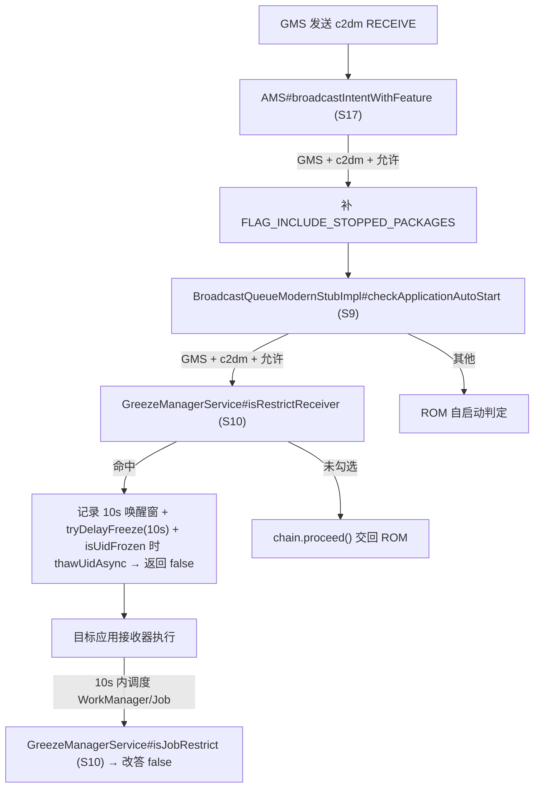

# HyperOS FCM Live：Hook 实现与诊断技术文档

> 本文档是仓库内唯一的技术实现与诊断参考，严格对齐当前源码、构建配置与 `META-INF/xposed` 清单；若与源码存在差异，以源码为准。
>
> **适用版本**：`4.6.0 (60)`　**更新日期**：2026-11-21
> **证据口径**：✅ 源码/字节码已核 · 🟡 真机实测记载 · ⚠️ 跨代待目标机复核

---

## 速览

- **作用域**：仅 `system`（`system_server`）与 `com.miui.powerkeeper`。不注入 `com.google.android.gms`（4.1.1 起退役，避免触发 GMS 完整性检测），不调用 `su`，不改 SELinux。
- **定位**：白名单收窄的系统省电策略放行器——放行 HyperOS 对 FCM 广播与 GMS 的冻结、自启动、Alarm、强停与睡眠断网限制；**不保活目标应用**，不阻断系统正常回收进程。
- **工程约束**：`minSdk 35`、`arm64-v8a`；所有 hook 回调遵守 **fail-open**（捕获异常并 `chain.proceed()`），不阻塞系统关键线程。
- **验收方式**：日志 tag `HyperGreeze`；开启「显示调试日志」后查看 `HyperFCMLive active in …: N hook(s) installed, M target(s) absent…`，或在模块「记录」页一键导出诊断文本。

---

## 1. 架构与运行时机制

### 1.1 加载、分组隔离与热重载

```text
LSPosed (META-INF/xposed/module.prop: minApi=101, targetApi=102, staticScope=true, autoHotReload=true)
  ├─ system_server        → Hooker.onSystemServerStarting → HookLog.refresh → systemServerGroups (21 groups) → logSummary
  └─ com.miui.powerkeeper → Hooker.onPackageReady [isFirstPackage] → HookLog.refresh → powerKeeperGroups (6 groups) → logSummary
```

- **分组隔离**：`Hooker` 将目标组织为 `systemServerGroups` 与 `powerKeeperGroups` 两张表；`InstallBookkeeping.installGroup` 捕获组级 `Throwable`（输出 `Failed to <verb> <name>`），单组失败不影响其余组安装。
- **去重与计数**：`hookE(executable)` 统一计入 `hooksInstalled`（包含探针与构造器 hook）并配套 `deoptimize`；API ≥ 102 时调用 `setId(executable.toGenericString())` 去重。
- **两级缺失记账**：本代应有却缺失走 `logSkip`（INFO，计入摘要 `target(s) absent`）；另一代才有的符号走 `logSkipOtherGeneration`（DEBUG，单独合并输出，不污染本代缺失计数）。
- **热重载语义**：`onHotReloading` 保存 `(process, classLoader)`；`onHotReloaded` 先遍历 `oldHookHandles` 执行 `unhook()` 再重跑安装。热重载路径会 flush 跨代缺失与探针，但**不经过 `onSystemServerStarting` / `logSummary`**，无摘要行属预期。

### 1.2 ClassLoader、线程与异常约束

| 维度 | 约束与实现 |
| --- | --- |
| **ClassLoader** | `services.jar` / `miui-services.jar` 走 `onSystemServerStarting` 的 `param.classLoader`（查找 `com.android.server.*` 必须用 host `classLoader.loadClass`，`Class.forName` 无法解析 boot classpath 成员）。`AmlMiuiThirdPartScorer` 位于 `miui-wifi-service.jar`，主 loader 不可达，需借 `MiuiWifiService` / `AmlConnectivityService` / `MiuiNetPathOptimizerService` binder 实现类 loader，并由后台线程 `fcmlive-wifi-scorer` 重试 40×3s。 |
| **多进程隔离** | `system_server` 与 `com.miui.powerkeeper` 各自持有一份 `Hooker` 与 `InstallBookkeeping`，静态状态与计数器不共享；remote prefs 在 hook 进程只读，由模块 UI 通过 `XposedService` 写入。 |
| **线程模型** | hook 回调运行在系统/binder 线程，禁止 sleep、磁盘/网络 IO 或切协程。重活交由独立线程：`fcmlive-allowlist`（串行化配置重载与扫描）、`fcmlive-allowlist-register`（早启动接收器注册，120×1s 重试）、`fcmlive-wifi-scorer`（40×3s daemon）、睡眠退出恢复独立 `Thread`。 |
| **异常隔离** | 判定逻辑全部包裹 `try/catch (Throwable)`，异常仅记日志并 `chain.proceed()`；`getSystemContext()` 失败只记一次 WARN，`gmsUid()` 失败返回 `null` 并跳过。注意组级 try/catch 无法捕获 native crash / ANR / watchdog。 |

### 1.3 白名单、多用户与 FCM 识别

- **白名单语义（`AllowlistGate.moduleAppliesTo`）**：白名单是模块唯一的收窄手段。
  - `com.google.android.gms` / `com.google.android.gms.persistent` 无条件返回 `true`。
  - 空白名单对非 GMS 应用一律返回 `false`（维持系统原判）；读取远程配置失败时保留上次快照，绝不因读失败而全放行（fail-closed）。
  - 「自动勾选新装 FCM 应用」公式：`effective = allowlist ∪ (当前 FCM 扫描 − baseline)`；baseline 缺失时该扩宽自动关闭。
  - `ACTION_ALLOWLIST_CHANGED` 为 `RECEIVER_EXPORTED`，回调校验 `getSentFromPackage()` / `getSentFromUid()`，仅接受模块自身、system、root、shell。
- **多用户兼容**：`Hooker.isGmsUid(uid)` 使用 `uid % 100000` 兼容副用户与手机分身（`userId=999`）；GMS 后台控制回写与扫描支持多用户路径。
- **FCM 客户端识别（`FcmAppScan` / `ProcessCleanerHooks`）**：用于列表可见性与防强停守门。检查五项信号：① `FirebaseMessagingService` 子类、② `FirebaseInstanceIdReceiver`、③ `MESSAGING_EVENT`、④ c2dm `RECEIVE`、⑤ Google 通知平台 `PushReceiver`；满足 **②③④ 任二，或 ② / ③ / ⑤ 任一单独命中** 即判定为 FCM 客户端（仅 ① 或仅 ④ 不算）。

### 1.4 核心文件索引

| 文件 | 职责 |
| --- | --- |
| [Hooker.kt](HyperFCMLive/src/main/java/io/github/iamqwert/hypergreeze/Hooker.kt) | 模块入口、分组表、生命周期、GMS UID 与系统上下文 |
| [InstallBookkeeping.kt](HyperFCMLive/src/main/java/io/github/iamqwert/hypergreeze/InstallBookkeeping.kt) | hook 计数、`setId` 去重、两级缺失与探针合并摘要 |
| [HookLog.kt](HyperFCMLive/src/main/java/io/github/iamqwert/hypergreeze/HookLog.kt) | `HyperGreeze` 调试日志门控 |
| [AllowlistGate.kt](HyperFCMLive/src/main/java/io/github/iamqwert/hypergreeze/AllowlistGate.kt) | 白名单加载/刷新、自动勾选与发送者校验 |
| [GreezeHooks.kt](HyperFCMLive/src/main/java/io/github/iamqwert/hypergreeze/GreezeHooks.kt) | greeze 冻结、广播、网络、wakelock、c2dm 后 10s Job 放行 |
| [GmsSupport.kt](HyperFCMLive/src/main/java/io/github/iamqwert/hypergreeze/GmsSupport.kt) | `GmsObserver`、`NetdExecutor`、不限制名单、场景编译、P4 恢复 |
| [AmsHooks.kt](HyperFCMLive/src/main/java/io/github/iamqwert/hypergreeze/AmsHooks.kt) | AMS 广播投递（补 `FLAG_INCLUDE_STOPPED_PACKAGES`） |
| [ProcessCleanerHooks.kt](HyperFCMLive/src/main/java/io/github/iamqwert/hypergreeze/ProcessCleanerHooks.kt) | `ProcessManagerService#isForceStopEnable` 防误强停与 FCM 识别 |
| [AlarmGate.kt](HyperFCMLive/src/main/java/io/github/iamqwert/hypergreeze/AlarmGate.kt) | GMS Alarm 投递、息屏对齐/延迟跳过与 SSRU 豁免 |
| [SleepModeGate.kt](HyperFCMLive/src/main/java/io/github/iamqwert/hypergreeze/SleepModeGate.kt) | 旧代睡眠链保护 + PowerKeeper 手机/平板睡眠保网 |
| [AutostartGate.kt](HyperFCMLive/src/main/java/io/github/iamqwert/hypergreeze/AutostartGate.kt) | 实验性服务绑定门与进程重启门（全链只读，不写 AppOp） |
| [WifiWeakSignalSwitch.kt](HyperFCMLive/src/main/java/io/github/iamqwert/hypergreeze/WifiWeakSignalSwitch.kt) | 弱 WiFi 评分临时 clamp |
| [SmartPowerHooks.kt](HyperFCMLive/src/main/java/io/github/iamqwert/hypergreeze/SmartPowerHooks.kt) | OS3 SmartPower 广播/服务拦截放行 |
| [PowerKeeperHooks.kt](HyperFCMLive/src/main/java/io/github/iamqwert/hypergreeze/PowerKeeperHooks.kt) | `AppStandbyController`、不限制名单、微信 doze keepout |
| [SystemProbes.kt](HyperFCMLive/src/main/java/io/github/iamqwert/hypergreeze/SystemProbes.kt) | 启动期只读存在性探针 |
| [HookerSupport.kt](HyperFCMLive/src/main/java/io/github/iamqwert/hypergreeze/HookerSupport.kt) / [Prefs.kt](HyperFCMLive/src/main/java/io/github/iamqwert/hypergreeze/Prefs.kt) | 反射工具、常量、配置键与主/子开关规则 |

---

## 2. FCM 投递链路与判定矩阵

### 2.1 简化调用链



> `isAllowBroadcast`（S2）的唯一调用方是 `isRestrictReceiver`（S10）；c2dm 在 S10 入口即已作答，S2 仅保留 GMS 自身的 `CN_DEFER_BROADCAST` 分支。

### 2.2 核心判定矩阵

| 触发条件 | 介入点 | 模块行为 |
| --- | --- | --- |
| `caller = GMS` + `action = c2dm.RECEIVE` + `callee ∈ 允许集` | S17 / S9 / S10 | 补 stopped 标志 → 入口答 `true` → 记 10s 唤醒窗、`tryDelayFreeze(10s)`、若已冻则 `thawUidAsync` 并返 `false` |
| 同上但 `callee ∉ 允许集` | S17 / S9 / S10 | 全部 `chain.proceed()`，表现与未装模块一致 |
| `callee = GMS` + `action ∈ CN_DEFER_BROADCAST` | S2 | `isAllowBroadcast` 返 `true`，防止 GMS 内部重连广播被延迟 |
| `uid` 处于收到 c2dm 后的 10s 窗口且 ROM 判 `isJobRestrict=true` | S10 | 改答 `false`，避免依赖 WorkManager 的 FCM 客户端推送后 Job 被冻结门拦下 |
| `uid = GMS` 进入 `isRestrictNet` / `udpPackageRestrict(allow=true)` | S7 / S19 | 返 `false` / 跳过，防止 GMS 被断网或加 UDP 过滤 |
| `uid = GMS` 进入 Alarm 投递 / 对齐 / 延迟 / SSRU 判定 | S21 | 投递与 SSRU 改答 `true`，`alignAlarmLocked` / `adjustAlarmLocked` 入口返 `false` |
| `isForceStopEnable` ROM 判 `true` + 白名单 + FCM 客户端 + `policy ≠ 13` | S20 | 改答 `false`（降级为普通杀进程，不置 `STOPPED`） |

---

## 3. AOSP 与 HyperOS 门控对照（OTA 复查基线）

本表对照 `services.jar` / `miui-services.jar` 与 GMS 26.41.62 实证，用于 ROM OTA 后按门复查：

| 机制（High / Normal） | 本 ROM 实门 | 模块干预 | 边界结论 |
| --- | --- | --- | --- |
| **FCM 广播投递** | `checkApplicationAutoStart`（CN 走 wake-path）+ `isRestrictReceiver` + AMS stopped 标志 | S9 / S10 / S17 | 恰当 |
| **Temp Allowlist / 休眠唤醒** | `DeviceIdleController#addPowerSaveTempWhitelistAppDirectInternal`；GMS 已替目标申请 `type0` 10s（reason 101/102）或 `type4` 20s（reason 105） | 无 | **不干预**：`DeviceIdleController` 对同 appId 为覆盖写，模块补短豁免反而会截断 GMS 的更长条目 |
| **进程启动 / 重启门** | `ProcessManagerService#isAllowAutoStart`（实体即 `checkOpNoThrow(10008)`） | S25（实验，默认关） | 仅覆盖重启/预加载，不写 AppOp |
| **后台 Service / FGS** | `startServiceLocked` 与 `setFgsRestrictionLocked` 均无 MIUI 注入（走 AOSP + GMS `type0`）；`isAllowStartService` 实为 bind/Job/重启门 | S24（实验，默认关） | 无可恢复的 MIUI FGS 门 |
| **Doze / 冻结网络** | temp allowlist + deviceidle 白名单 + `isRestrictNet` + `mNoNetworkBlackUids` | S7 / S15 + 实验 `greeze_net_release` | 恰当 |
| **App Standby / 省电策略** | PowerKeeper `AppStandbyController#setUidState`、userTable `bgControl`、`MILLET_NO_RESTRICT_APP` | P12 / P14 / P16 / P17 | 恰当 |
| **Partial WakeLock** | `GreezeManagerService#isAllowWakeUpList` → `AurogonImmobulusMode#isAllowWakeUpList(pkg)` | S30（仅 GMS） | 不扩至第三方 App（AOSP `no_cached_wake_locks` 原生禁缓存锁） |
| **JobScheduler / WorkManager** | `FreezeStatusRestriction#isJobRestricted` → `GreezeManagerService#isJobRestrict` | S10（仅 c2dm 后 10s 窗口） | 严格限窗，不放开常规后台 Job |
| **AlarmManager** | `AlarmManagerServiceStubImpl`（国行 `ADJUST_WHITE_LIST` 不含 GMS） | S21（仅 GMS/GSF） | 恰当 |

---

## 4. 现役 Hook 清单

> `scripts/check_hook_targets.py` 直接解析 §4.1 与 §4.2 表格（`#`、目标版本、方法签名、Hook 类型列）用于 OTA 回归核查；修改现役目标后需同步运行 `python3 scripts/check_hook_targets.py --write` 更新基线。已删除的历史钩点归档于 §6.2。

### 4.1 system_server 现役修改点

| # | 目标版本 | 类 | 方法/字段签名 | Hook 类型 | 修改逻辑与目的 | 失败表现与兼容备注 |
| --- | --- | --- | --- | --- | --- | --- |
| S1 | OS3/OS4 | `AllowlistGate`（模块自身） | remote prefs `config` + `ACTION_ALLOWLIST_CHANGED` | 接收器/配置 | 启动读白名单，收到广播后后台重载；包安装/替换触发自动勾选扫描 | 注册失败 WARN；外部发送者 WARN；`RECEIVER_EXPORTED` + sender 校验 |
| S2 | OS3/OS4 | `com.miui.server.greeze.GreezeManagerService` | `isAllowBroadcast(int, String, int, String, String)` | 替换返回值 | `callee` 为 GMS 且 `action ∈ CN_DEFER_BROADCAST` → `true`；其余 `proceed` | 缺失 ERROR；arg 序：`callerUid, callerPkg, calleeUid, calleePkg, action` |
| S4 | OS3/OS4 | `GreezeManagerService` | `triggerGMSLimitAction()` | 跳过方法体 | 直接返回 `null`，阻断息屏延迟消息（`what=10`）将 GMS 移出 Aurogon 白名单并触发快冻 | 缺失 INFO；✅ OS3/OS4 签名一致，由 `GreezeManagerService$12$1#run()` 在息屏触发 |
| S5 | OS4 | `GreezeManagerService` | `updateGmsNetStatus(boolean)` | 改写参数 | 参数强制 `false`，关闭框架侧 GMS 网络限额 | 缺失跨代 DEBUG（✅ OS3 dump 实证无此方法） |
| S7 | OS3/OS4 | `com.miui.server.greeze.DomesticPolicyManager` | `isRestrictNet(int)` | 替换返回值 | GMS uid → `false`；`greeze_net_release` 开且白名单包 → `false` | 缺失 INFO；极性 `true=限制`（`!mMessageApp.contains`），唯一调用点 `freezeUids` |
| S8 | OS3/OS4 | `com.miui.server.greeze.power.ListAppsManager` | 构造器；字段 `mUseDataWhiteList` / `USE_DATA_WHITE_LIST` | 构造后置/集合修改 | 构造后将 GMS 加入 use-data 白名单，获得 `preCheckSystemApp` 的 `whiteapp` 豁免 | 字段缺失 ERROR；不再剪除 `SYSTEM_BLACK_LIST`（该表为充电免冻理由） |
| S9 | OS3/OS4 | `BroadcastQueueModernStubImpl` | `checkApplicationAutoStart(BroadcastQueue, BroadcastRecord, ResolveInfo)` | 替换返回值 | `caller=GMS`（支持 `callingUid` 兜底）+ c2dm + 目标允许（支持 `activityInfo` 兜底）→ 入口返 `true` | 异常 ERROR + `proceed`；仅放行 GMS→c2dm |
| S10 | OS3/OS4 | `GreezeManagerService` | `isRestrictReceiver(Intent, int, String, int, String)`、`isUidFrozen(int)`、`thawUidAsync(int, int, String)`、`tryDelayFreeze(int, long, boolean)`、`isJobRestrict(int)` | 替换返回值 + 显式调用 | c2dm 命中：记 10s 唤醒窗，先 `tryDelayFreeze(uid, 10000L, true)`，仅 `isUidFrozen` 为 true 时 `thawUidAsync`，再返 `false`；`isJobRestrict` 仅在 ROM 判 true 且 uid 处于 10s 窗内改答 `false` | 缺失 INFO/ERROR；`tryDelayFreeze` 内部取 `max` 不截断更长宽限；刻意不短接 `checkReceiverIfRestricted` |
| S12 | OS3/OS4 | `AurogonImmobulusMode` | `isNoRestrictApp(String)`、`isNoRestrictFreezeable(String, int)`、`triggerQuickFreeze(int, int)` | 替换返回值 | GMS → `true` / `false` / skip，作为冻结主链安全网 | 缺失 INFO 或跨代 DEBUG（`isNoRestrictFreezeable` 为 OS4 新增） |
| S13 | OS3/OS4 | `PolicyMaker` | `isAllowFreeze(int)` | 替换返回值 | GMS uid → `0`（`CANNOT_FREEZE`） | 缺失 INFO；注意返回类型为 `int` 而非 `boolean` |
| S14 | OS3/OS4 | `ProcessPolicy` | `getWhiteList(int)` | 方法后置/返回值 | `flags` bit0 命中且结果缺 GMS 时追加 GMS | 异常 ERROR；OS4 静态种子已含 GMS，保留作 OS3 兜底；已配 `deoptimize` |
| S15 | OS3/OS4 | `AwareResourceControl` | 构造器；字段 `mNoNetworkBlackUids` | 构造后置/集合修改 | 构造后按包名从 `List<String>` 移除 GMS，防止列入无网黑名单 | 字段异常 ERROR；不匹配打 INFO |
| S16 | OS3/OS4 | `MiuiNetworkPolicyManagerService` | `setSleepModeWhitelistUidRules()`、`enableSleepModeChain(boolean)`；字段 `mSleepModeWhitelistUids` | 方法前/后置 + sentinel | 旧代睡眠链注入 GMS 白名单；仅当本次开机观测到 `enableSleepModeChain(true)` 且 GMS 未入白名单时，退出才触发 P4 重连 | 缺失跨代 DEBUG；OS4/V816 睡眠断网在 PowerKeeper，本链作哨兵与 OS3 保护 |
| S17 | OS3/OS4 | `ActivityManagerService` | `broadcastIntentWithFeature`（多签名）/ `broadcastIntent` | 方法后置/字段修改 | GMS + c2dm + 目标允许：仅补 `FLAG_INCLUDE_STOPPED_PACKAGES` | 缺失 ERROR；不再覆盖写 2s temp allowlist（见 §3） |
| S19 | OS3/OS4 | `GreezeManagerService` | `udpPackageRestrict(int, boolean)` | 替换返回值 | GMS uid 且 `allow=true` → 跳过（`null`），防止冻结路径挂载 UDP 过滤 | 缺失 INFO；仅跳过 `true` 避免卡死解除路径 |
| S20 | OS3/OS4 | `ProcessManagerService` | `isForceStopEnable(ProcessRecord, int)` | 方法后置/替换 | ROM 判 `true` + 白名单 + FCM 客户端 + `policy ≠ 13` → `false`（降级为普通杀） | 异常 ERROR；下沉至 `ProcessManagerService` 同时覆盖常规清理与内存压力清理；已配 `deoptimize` |
| S21 | OS3/OS4 | `AlarmManagerServiceStubImpl` / `AlarmManagerServiceStub` | `checkAlarmIsAllowedSend(Context, Alarm)`、`alignAlarmLocked(Alarm)`、`adjustAlarmLocked(Alarm)`、`isExemptFromSsru(Alarm)` | 方法前/后置替换 | GMS/GSF uid：投递与 SSRU 判 `false` 时改答 `true`；`align`/`adjust` 入口直接返 `false` | 缺失 INFO / 跨代 DEBUG；✅ OS3/OS4 签名一致，国行 `ADJUST_WHITE_LIST` 不含 GMS |
| S22 | OS4（OS3 待验证） | `AmlMiuiThirdPartScorer` | `notifyScoreAndIsUsable()`；字段 `mLegacyIntScore` | 方法前后置/字段 | 弱 WiFi 开关开且 `50 > score ≥ floor`：临时置 `51`，调用后还原 | 解析失败跨代 DEBUG；位于 `miui-wifi-service.jar`，异步重试解析 |
| S23 | OS3 | `SmartPowerService` / `SmartPowerPolicyManager` | `shouldInterceptBroadcast(ProcessRecord, BroadcastRecord)`、`shouldInterceptService(Intent, CallerInfo, ServiceInfo)` | 替换返回值 | 开关开 + GMS+c2dm/白名单 → `false` | OS4 跨代 DEBUG（OS4 无此拦截层） |
| S24 | OS3/OS4 | `AutoStartManagerServiceStubImpl` | `isAllowStartService`（3 参 / 4 参重载） | 方法后置/替换 | 先 `proceed()`；仅 ROM 判 `false` 且 `autostart_service_release` 开 + 白名单包 → `true` | 缺失跨代 DEBUG；实为 bind/Job/重启门，先 `proceed()` 保留弹幕门与 `10008` 记账 |
| S25 | OS3/OS4 | `ProcessManagerService` | `isAllowAutoStart(String, int)` | 方法后置/替换 | 先 `proceed()`；仅 ROM 判 `false` 且 `autostart_process_release` 开 + 白名单包 → `true` | 缺失 INFO；覆盖进程重启/预加载（非 c2dm 冷启动） |
| S30 | OS3/OS4 | `GreezeManagerService` | `isAllowWakeUpList(int)` | 替换返回值 | GMS uid → `true`，防止缓存/冻结态 partial wakelock 被禁 | 缺失 INFO；每次 app partial wakelock 均会查询 |

### 4.2 PowerKeeper 现役修改点

| # | 目标版本 | 类 | 方法/字段签名 | Hook 类型 | 修改逻辑与目的 | 失败表现与兼容备注 |
| --- | --- | --- | --- | --- | --- | --- |
| P1 | OS3 | `com.miui.powerkeeper.utils.NetdExecutor` | `initGmsChain(String, int, String)` | 改写参数 | 第 3 参数改为 `"ACCEPT"`，中和 OS3 `gms_wall` REJECT 链 | 跨代 DEBUG |
| P3 | OS3 | `NetdExecutor` | `setGmsChainState(String, boolean)` | 改写参数 | 第 2 参数改为 `false`，关闭 `gms_wall` | 跨代 DEBUG |
| P4 | OS3/OS4 | `NetdExecutor` | `execute(int, String, String, Object[])` | 改写参数/替换返回 | `setuiddnsrule` + GMS uid → 参数改 `allow`；`enablemiuistandby enable` → 跳过 | 缺失 INFO；仅改写可确证为 GMS 的 uid |
| P5 | OS3 | `GmsObserver` | `updateGmsAlarm(boolean)`、`updateGmsNetWork(boolean)`、`updateGoogleReletivesWakelock(boolean)` | 改写参数 | 参数强制 `false`，屏蔽 OS3 本地限额状态机 | 跨代 DEBUG |
| P6 | OS3 | `GmsObserver` | `disableGms()` | 替换返回值 | 返回 `null`，阻止硬禁用 GMS | 跨代 DEBUG |
| P7 | OS3 | `GmsObserver` | `updateGmsEnabled(boolean)`、`updateGmsState(boolean)`、`updateGmsInstalled(boolean)` | 改写参数 | 参数强制 `false` | 跨代 DEBUG |
| P9 | OS3/OS4 | `GmsObserver` | `onGoogleReachabilityChanged(boolean)` | 改写参数 | 参数强制 `true`，保持可达状态 | 缺失 INFO；OS3 上为可达性唯一入口，OS4 上与 S5 幂等 |
| P12 | OS3/OS4 | `AppStandbyController` | `setUidState(int, boolean)` | 改写参数 | GMS uid 且参数非 `true` 时改为 `true` | 缺失 INFO；不预置 `mUidState` 缓存以免短路恢复路径 |
| P14 | OS3/OS4 | `UserConfigureHelper` | `getNoRestrictApps(Context)` | 方法后置/返回值 | 查询结果缺 GMS 时注入 GMS（只改内存投影，不在查询路径写 provider） | 缺失 INFO |
| P16 | OS3/OS4 | `ActiveStateController` | `dealNoRestrictApp()` | 方法后置 | 调用后执行 `ensureGmsInMilletSetting` 与 userTable `bgControl` 修复 | 缺失 INFO；写失败 WARN；仅在缺项时写 |
| P17 | OS3/OS4 | `PowerKeeperAppConfigure` | `fillScenarioContent`（7 参 OS3 / 8 参 OS4）；字段 `pkg`、`scenario` | 方法后置/字段 | GMS 场景 `0 → 8`（无限制），对齐 UI 与 DeviceIdle 策略 | 缺失跨代 DEBUG；按参数个数匹配 |
| P18 | OS3/OS4 | `CommonAdapter` | `addPowerSaveWhitelistApps`（2 参） | 改写参数 | `wechat_doze_keepout` 开时从 `String[]` 移除微信，阻止系统写回未优化名单 | 缺失 INFO；默认关，不清理已存条目 |
| P19 | OS3/OS4 | `WifiManager` | `setWifiEnabled(boolean)` | 替换返回值 | 睡眠进入 + `sleep_keepalive` 开 + 栈含 `PhoneSleepModeController` / `PadSleepModeController#applySleepConfig` → 返回 `true` | 缺失 INFO；P19/P20 任一目标缺失则整组不装（WARN） |
| P20 | OS3/OS4 | `CommonAdapter` | `setDataEnabled(TelephonyManager, boolean)` | 替换返回值 | 同 P19 条件（读 `sleep_keepalive_data`）→ 返回 `null` | 缺失 INFO；与 P19 成对装载 |
| P22 | OS3/OS4 | `GmsSupport` | `recoverGmsConnection(Context)` | 非 hook | 向 GMS/GSF 发送 GCM/GTALK/MCS 重连与心跳广播并 query Chimera（outbound IPC） | 发送失败 WARN；仅在睡眠退出或补写名单时触发 |

### 4.3 实验开关与只读探针

**配置开关**（均位于 [Prefs.kt](HyperFCMLive/src/main/java/io/github/iamqwert/hypergreeze/Prefs.kt)，默认全关；子开关在 hook 读点必须与主开关做逻辑 AND）：

| 配置键 | 默认 | 落点 | 说明 |
| --- | --- | --- | --- |
| `debug_log` | 关 | `HookLog` | 放开 INFO/DEBUG 日志输出 |
| `sleep_keepalive` / `sleep_keepalive_data` | 关 | P19 / P20 | 睡眠进入时不关 WiFi / 移动数据（设备级耗电） |
| `wechat_doze_keepout` | 关 | P18 | 阻止系统将微信写回 AOSP 未优化名单（需先手动设优化） |
| `wifi_weak_signal_switch_relaxed` / `wifi_weak_signal_floor` | 关 / 45 | S22 | 评分处于 `[floor, 50)` 时临时 clamp 至 `51`（可选 `45/40/35/30`） |
| `greeze_net_release` | 关 | S7 | 白名单应用冻结期间保持联网 |
| `autostart_service_release` / `autostart_process_release` | 关 | S24 / S25 | 放行服务绑定门 / 进程重启门（仅改写 ROM 的拒绝） |
| `smartpower_release` | 关 | S23 | OS3 SmartPower 广播/服务拦截放行 |
| `auto_check_new_apps` | 关 | `AllowlistGate` | 按 `allowlist ∪ (scan − baseline)` 自动放行新装 FCM 应用 |

**现役只读探针**（[SystemProbes.kt](HyperFCMLive/src/main/java/io/github/iamqwert/hypergreeze/SystemProbes.kt)，启动时采样一次并合并为 `probe: ...`）：
- **R3** `AurogonImmobulusMode.mMessageApp`：检查 GMS 是否在消息豁免表（不在则冻结期 `isRestrictNet` 会为 true）。
- **R4** `ConnectivityManager#updateSleepModeUidRule` / `enableSleepModeChain`：检查旧代睡眠链反射入口存在性。
- **R5** `FilterEnablePolicy#isSupportPacketFilter`：检查 UDP 包过滤能力。
- **R8** `AppOpsManager` `10008`：启动期只读统计白名单应用自启动行为 op 状态。

### 4.4 持久化写点审计

全仓实测写面仅 **3 处**（不写 `MIUIOP 10008` / `10053`，不写 `cloud_min_rssi_*`，不执行 `su`）：

| 写点 | 目标 | 写入内容与触发 | 卸载回滚 |
| --- | --- | --- | --- |
| `ensureGmsInMilletSetting` | `Settings.System.MILLET_NO_RESTRICT_APP` | 缺项或 P16 后追加 GMS | 手动编辑或清空该 Settings 键 |
| `ensureGmsUserTableBgControl` | `content://com.miui.powerkeeper.configure/userTable` | GMS 行 `bgControl=noRestrict`（支持多用户）；首次/P17/P16 触发 | 在省电策略中重新调整或重置 |
| 微信 doze keepout（间接） | AOSP `deviceidle` 白名单 | 仅从 ROM 写入参数中剔除微信，落盘者为 ROM | 系统电池优化页手动调整 |

---

## 5. 诊断、日志与 GcmService 取证

### 5.1 日志门控与一次性哨兵

- **日志门**：tag 固定为 `HyperGreeze`。`WARN` / `ERROR` 始终输出；`INFO` / `DEBUG` 仅在开启 `debug_log` 后输出。**日志为空不等于未生效**。
- **安装摘要（INFO）**：
  ```text
  HyperFCMLive active in system_server: <N> hook(s) installed, <M> target(s) absent on this ROM, <K> cross-generation (expected)
  HyperFCMLive active in com.miui.powerkeeper: <N> hook(s) installed, <M> target(s) absent on this ROM, <K> cross-generation (expected)
  ```
- **一次性哨兵**：4.4.0 起已撤除 30min 周期计数与 `TrafficProbe`，改为每进程一次的哨兵行——**无声即该分支在本次启动未被 ROM 走到**：
  - `isRestrictReceiver: c2dm allowed for callee=…`（S10 放行真实推送）
  - `checkApplicationAutoStart: c2dm allowed …`（S9 冷启动放行）
  - `autostart gate: re-allowed … after the ROM denied …`（S24 / S25 真正改答了拒绝）
  - `no-restrict chain: isNoRestrictApp(GMS) answered true` / `Removed GMS from NoNetworkBlackUids`（S12 / S15 承重）
  - `sleep-mode sentinel: legacy path FIRED`（S16 旧代睡眠链被走到；OS4 上应静默）

### 5.2 诊断命令与排障速查

首选直接从模块 **「记录」页 → 导出诊断文本**（包含钩子装载摘要与 FCM 状态/事件，无需开启调试日志或连接电脑）。需要深度取证时：

```bash
# 1. 安装与异常过滤（需先开 debug_log，或直接看 LSPosed 导出的 modules_*.log）
adb logcat -v time -s HyperGreeze | grep -E "HyperFCMLive active|Failed to|target\\(s\\) absent|cross-generation"

# 2. 系统策略核查
adb shell dumpsys greezer                          # mCurrentCNPolicy / mGmsLimitEnabled / 冻结列表
adb shell dumpsys alarm                            # 按 statsTag 查 GCM_CONN_ALARM / GCM_HB_ALARM
adb shell dumpsys activity service com.google.android.gms/.gcm.GcmService > gcm.txt
adb shell settings get system MILLET_NO_RESTRICT_APP
adb shell am broadcast -a io.github.iamqwert.hypergreeze.ALLOWLIST_CHANGED  # 强制重载白名单
```

**常见误判与二分原则**：
- **手工 `adb am broadcast -a com.google.android.c2dm.intent.RECEIVE` 不能替代真实推送**：caller 是 shell 而非 GMS，不会命中 S9/S10 的 caller 判定。
- **热重载后无 `HyperFCMLive active` 行属正常**（见 §1.1）。
- **`cross-generation` 缺失属正常**：OS4 上 OS3-only 钩（P1/P3/P5/P6/P7/S23）缺失不会计入本代 absent。
- **二分排障顺序**：关所有实验开关 → 禁用模块 → 在 `Hooker.kt` 注释单个 `Group` 重装验证。崩溃/卡死时优先在 LSPosed 禁用模块并抓取 `adb logcat -b all -v threadtime -d` 与 `dumpsys dropbox`。

### 5.3 GcmService Dump 判读指南

基于 GMS 26.41.62 字节码（全表见本地参考文档 `FCM_DIAGNOSTICS_FORMATS.md`）与真机实证：

1. **`Close err:N` 必须结合前后行与重连代价分级**：
   | code | 官方名（`Ljjap;->a(I)`） | 共现特征 | 实测重连空窗 | 归因 |
   | --- | --- | --- | --- | --- |
   | `27` | `ERR_CLOSE_BY_NEW_CONNECTION` | `Active network switched` + `Starting parallel McsConnection` | 0.4 – 1.7 s（均 0.88 s） | 默认网络切换，并行建连优雅替换 |
   | `20` / `25` | `ERR_IO_FIN` / `ERR_CONNECTION_REFUSED_REMOTELY` | **成对出现且 `time:S` 相同**，伴 `Active network went away` | 0.9 – 22 s（均 7 – 9 s） | 旧网络失效（同一事件的读/写两侧，统计故障不可重复计数） |
   | `6` | `ERR_HEARTBEAT_ACK_TIMEOUT` | `Heartbeat alarm delay: N ms` | 视退避而定 | 心跳超时 |
   | `1` | `ERR_NET_DOWN` | `net=-1` | 无网 | 蜂窝与 WiFi 同时不可用 |

2. **用 `netId` 区分链路真断与默认网切换**：`GcmNetwork{<netId> <Type>(<typeId>)[ DISCONNECTED]...}` 中 `netId` 单次开机单调递增。WiFi 回来仍为同一 `netId` 说明链路未断、仅默认路由被切走；`netId` 换号说明网络对象销毁重建（真断）。同类型换 `netId`（如 `Cell 103 → Cell 107`）也是真实换网。
3. **四条掉网排除判据**：① `available:` 中 Cell 全程存在 ⇒ 排除睡眠整机断网；② Doze 进出次数与断线不成对 ⇒ 排除 Doze；③ 每次存活时长大幅抖动 ⇒ 排除固定定时器（如 `wifi_idle_ms`），指向外部链路/VPN；④ 查息屏切流量先比对 Doze 区间与 `settings get global wifi_sleep_policy`（`2` = 息屏保持），再按贡献排查 **VPN 上下线 > WiFi 链路抖动 > MIUI WiFi 评分切换**（`AmlWifiScoreReportInjector` 读取 `cloud_min_rssi_for_data_switch_*`，与切回阈值滞回带仅约 6 dBm）。
4. **两个易错读法**：
   - `Received <pkg> <msgid>` 仅代表 GMS 收到下行 stanza，不代表应用收到；需看正向完成耗时，且 `Failed to broadcast to stopped app` 为 Android 原生行为。
   - `HB interval sent` 按传输类型映射（WiFi/VPN `230000` ≈ 3.8 min，Cell `1680000` = 28 min），属于正常映射，不代表链路劣化。

### 5.4 结论措辞纪律

- 0 样本、单窗口阴性结果或缺少运行时闭合的静态推导，一律表述为**“未验证”**，不得据此断言“不需要/已失效”。
- 静态结论与真机运行态冲突时，**以运行时证据为准**。

---

## 6. 兼容性、二次开发与历史排除记录

### 6.1 OTA 适配与新增 Hook 规范

1. **拉取运行中框架**：`framework.jar`、`services.jar`、`miui-services.jar`、`miui-framework.jar`、`miui-wifi-service.jar`、`PowerKeeper.apk`，用 [DexSQL](https://github.com/LSPosed/dexsql-release/) 跨 jar 核实类、签名、返回类型与极性（不要只信 `versionName`，PowerKeeper `4.2.00` 在 OS3/OS4 内部实现不同）。
2. **禁止硬编码混淆名**：如 `DeviceIdlePolicyHelper` 的 `s`/`r` 随代次漂移，应锚定稳定入口（如 `AppStandbyController#setUidState`）。
3. **强制校验**：修改现役钩点后更新 §4.1/§4.2，运行：
   ```bash
   python3 scripts/check_docs.py
   python3 scripts/check_hook_targets.py --dex rom-dump --gen os4   # 必要时加 --write 更新基线
   ```
4. **新增 Hook 必过清单**：写清修改前/后与 fail-open 路径 → 走 `hookE` + `deoptimize` → 区分 `logSkip` / `logSkipOtherGeneration` → 补一次性命中哨兵 → 覆盖 OS3/OS4、空白名单、开关全关回归。

### 6.2 已退役与否决方案（防重复踩坑）

| 方案 / 历史编号 | 处置 | 核心依据与可复用教训 |
| --- | --- | --- |
| **GMS 进程内钩（原 GCM 重连修复）** | 4.1.1 移除 | GMS 热更新加强完整性检测，进程内 hook 会破坏设备完整性。 |
| **P7「连接层健康检查」**（30min 采样 + 闹钟节奏） | 2026-10-30 删除 | 无「网络/DNS 正常但 GMS 既不轮询也不重连」的现场样本，三条触发入口全部不可达。**留存取证**：`dumpsys alarm` 按 `statsTag`（`GCM_CONN_ALARM` / `GCM_HB_ALARM`）检索，重连/心跳走 `Alarm.listenerTag`（`operation=null`）；`AlarmStore` 在 OS4 为接口且 `LazyAlarmStore#add` 零命中，不可从排期表读重连闹钟。 |
| **`isNeedCachedBroadcast`（S11）** | 2026-10-30 删除 | 唯一调用方为 `isRestrictReceiver` 的 `else` 分支，已被 S10 全遮盖，且 CN 策略下 c2dm 不在缓存表。 |
| **`deferBroadcastForMiui`（S3） / `deferBroadcast`（S6）** | 2026-10-30 删除 | S3 需 `FULLY_FROZEN` 且 GMS 已在 S2 作答；S6 为纯计数探针。 |
| **`isNeedCachedAlarmForAurogon`（S31）** | 2026-10-30 删除 | 实体检查 `pkg.contains("xiaomi")`，GMS 恒返 `false`。 |
| **`InternationalPolicyManager#isPushApp`（S18）** | 2026-10-30 删除 | CN 机走 Domestic 该类不实例化；国际版 FCM 本不受限。 |
| **Domestic 强切 International 策略** | 否决 | `setCnModel` 影响整机地区模式，且 `onDeviceProvisionedChanged` 会打回；S7 已达成目标。 |
| **`isRestrictBackgroundAction`（W2）** | 证伪（不做） | `services.jar` 四处调用全部丢弃返回值，结构上不是拒绝门而是解冻决策。 |
| **放宽广播放行 action 集合（W9）** | 否决 | `MESSAGING_EVENT` 不在 GMS 发出；`INSTANCE_ID_EVENT` 仅 GMS 内部发；`RECEIVE_DIRECT_BOOT` 在 `RUNNING_LOCKED` 无第三方接收者。 |
| **自启动三档中的 `canRestartServiceLocked`（S26）与 `AppOpsManager` 根门（S28）** | 2026-10-31 删除 | `restart DENIED` 不影响投递；不再拦截 `10008` 根查询，仅保留 S24（服务绑定门）与 S25（进程重启门）。 |
| **`P8 / P10 / P11 / P13 / P15 / P21`** | 2026-10-30 删除 | P8 由 S5 承担；P10/P11 唯一出口为 P9；P13 在本机 doze 白名单恒 no-op；P15 命中实例 setter 无效；P21 降级分支结构性不可达且增加 `Settings$Secure` 全量开销。 |
| **`/proc/net/tcp` 扫描 & `TrafficProbe`（S29）** | 2026-10-30 删除 | SELinux Enforcing 不可读且无法识别静默 DROP；GcmService dump 信息严格更完整。 |
| **充电条件睡眠子开关 & `wechat_battery_shield`** | 已删除 | 充电夜不构成有效区分且 fail-closed 会丢保活；微信省电策略升格熔断只发生一次，改由 P18 守 AOSP doze 名单。 |
| **扩展 P4 重连触发面（亮屏 / 投递前）** | 否决 | P4 会令 GMS 主动拆掉当前 MCS，属破坏性动作，仅在确有假死风险（睡眠退出/补写名单）时使用。 |
