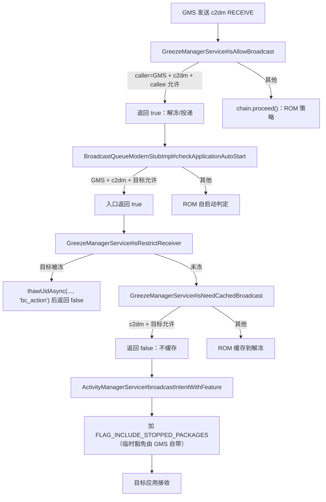

# HyperOS FCM Live：Hook 实现与诊断办法

> **本文是仓库内唯一的技术文档**（原 `HOOKS_AND_DIAGNOSTICS.md` 已并入本文并删除）。内容只基于当前仓库源码、构建配置、`META-INF/xposed` 清单、资源字符串与现有工程记录；如与源码冲突，以源码为准。
>
> **文档版本**：1.0　**更新日期**：2026-10-22　**适用模块**：`4.2.0 (54)`　**证据口径**：见 §1（标记表）

---

## TL;DR / 快速结论

| 问题         | 结论                                                                                                                                                                                                                           |
| ------------ | ------------------------------------------------------------------------------------------------------------------------------------------------------------------------------------------------------------------------------ |
| 模块改了什么 | 只在 `system`（system_server）与 `com.miui.powerkeeper` 两个进程挂 hook，放行 HyperOS 对 **GMS/FCM 推送链路**的冻结、广播、自启动、Alarm、睡眠断网等限制；不注入 GMS，不调用 `su`，不改 SELinux。                              |
| 核心机制     | 在 `com.miui.server.greeze.*`、`com.miui.powerkeeper.*`、AOSP `ActivityManagerService`、`AlarmManagerService`、`AppOpsManager`、`ProcessCleanerBase` 等目标上做**返回值改写、参数改写、字段/集合注入、构造后剪除、只读探针**。 |
| 用户效果     | 勾选应用的 FCM 推送在后台/睡眠/被清理时更稳；另有默认关闭的实验开关（睡眠保 WiFi/数据、自启动放行、弱 WiFi 保持、微信 doze、自动勾选等）。                                                                                     |
| 怎么确认生效 | 日志 tag `HyperGreeze`；开「显示调试日志」后看 `HyperFCMLive active in …: N hook(s) installed, M target(s) absent…`；每 30 分钟一行 `gms probe` 带计数器。                                                                     |
| 失败语义     | **fail-open**：判定异常只记日志并 `chain.proceed()`，不阻断 ROM。目标缺失分两级：`logSkip`（INFO，本代应有）与 `logSkipOtherGeneration`（DEBUG，另一代才有）。                                                                 |
| 最大风险     | 钩点强依赖 HyperOS 代次；**OS3 与 OS4 符号差异极大**。ROM OTA / PowerKeeper 更新 / GMS 更新后必须重新验证。                                                                                                                    |
| 回滚         | LSPosed 取消作用域并重启；卸载模块。注意 `MILLET_NO_RESTRICT_APP`、userTable `bgControl` 等持久化写入可能残留，见 §8.4；`10053` 只可能来自 4.1.x 及更早的构建（4.2.0 起不再写）。                                              |
| 不做什么     | 不 hook GMS（4.1.1 起 GMS 侧钩族退役）；不支持 Android < 15；不保证应用被 force-stop/断网时仍能收到推送。                                                                                                                      |

**一句话**：这是一个**白名单收窄**的“系统省电策略放行器”，不是“保活器”，也不是“万能推送修复器”。

---

## 1. 文档说明

| 标记                | 含义                                              |
| ------------------- | ------------------------------------------------- |
| ✅ **已验证事实**    | 可从当前源码、构建配置、清单文件直接核对          |
| 🟡 **源码注释记载**  | 项目作者在真机/反汇编中记录的结论，本次未重新复测 |
| 🔸 **推测**         | 由源码行为或反汇编推导，需运行时验证              |
| ⚠️ **待验证/待确认** | 依赖具体 ROM 代次，必须在目标设备上重新确认       |
| 【待确认】          | 材料缺失，不能下结论                              |

---

## 2. 模块概览

### 2.1 解决的问题

HyperOS 可能在以下位置影响 FCM 送达（根据源码注释中的真机/反汇编记录；不同 ROM 分支是否走到这些路径，必须用日志与 `dumpsys` 复核）：

| 机制                 | 可能行为                                        | 模块对应干预                                                                                                   |
| -------------------- | ----------------------------------------------- | -------------------------------------------------------------------------------------------------------------- |
| greeze 冻结/广播策略 | 冻结 GMS 或将 c2dm 广播缓存到解锁后             | `GreezeManagerService#isAllowBroadcast`、`isNeedCachedBroadcast`、`isRestrictReceiver`                         |
| 自启动               | 服务/进程启动检查读取 `MIUIOP 10008`            | `checkApplicationAutoStart`、`isAllowStartService`、`isAllowAutoStart`、`canRestartServiceLocked`、AppOps 根闸 |
| 清理/force-stop      | `ProcessCleanerBase#isForceStopEnable` 允许清理 | 对白名单内 FCM 客户端返回 false                                                                                |
| 睡眠模式             | OS4 在 PowerKeeper 直接关 WiFi/移动数据         | `SleepModeGate.hookSleepModeNetworkKeepalive`                                                                  |
| Alarm                | `checkAlarmIsAllowedSend` 丢弃到期 alarm        | GMS uid 改答允许                                                                                               |
| 停止应用             | c2dm 因 stopped 标志被拒                        | `FLAG_INCLUDE_STOPPED_PACKAGES`（临时豁免由 GMS 自带）                                                        |
| 弱 WiFi              | 评分 < 50 时切到移动数据                        | `AmlMiuiThirdPartScorer` 临时 clamp                                                                            |
| OS3 SmartPower       | 拦截广播/服务启动                               | OS3-only 两个 hook                                                                                             |

### 2.2 不做什么

- **不保活**：不会无条件维持应用进程；只放行特定系统检查点。
- **不绕过全部限制**：应用被 force-stop、网络被物理切断、ROM 走了未覆盖的新路径时，仍可能收不到。
- **不改善 WiFi 质量**：弱信号开关只是减少 WiFi/移动数据切换。
- **不清理已存在的微信电池优化条目**：只阻止下一次写回，需用户手动把微信设为“优化”。
- **不写自启动 AppOp**：`10008` 行为 op 与 `10053` 手机管家开关 op 都只读（4.2.0 删掉了 `10053` 的开机回填）。
- **不 hook GMS**：GMS 侧钩族已在 4.1.1 退役，避免热更新完整性判定。
- **不支持 Android 14 及以下**：`minSdk 35`。

### 2.3 作用域、入口、初始化流程

**作用域**：只有 `system` 与 `com.miui.powerkeeper`。这意味着：

- system_server 的所有 hook 与 probe 在系统进程内运行。
- PowerKeeper 的 hook 在 `com.miui.powerkeeper` 进程内运行。
- 模块设置 App 本身**不被 hook**；它通过 libxposed remote prefs 与广播驱动 system_server 侧配置。

**初始化顺序**：

1. LSPosed 读取 `java_init.list`，实例化 `Hooker`。
2. system_server：`onSystemServerStarting` → 保存 `(process, classLoader)` → `HookLog.refresh` → `hookSystemServer` → 逐组安装 → `logSummary("system_server")`。
3. PowerKeeper：`onPackageReady`（`isFirstPackage`）→ 保存 `(packageName, classLoader)` → `HookLog.refresh` → `hookPackage` → 仅 `com.miui.powerkeeper` 安装 → `logSummary(packageName)`。
4. 热重载：`onHotReloading` 保存状态并返回 true；`onHotReloaded` `unhook()` 旧句柄后重新安装。
5. 配置变更：`ACTION_ALLOWLIST_CHANGED` → `AllowlistGate.loadAllowlistFromRemotePrefs`；实验开关在 hook 回调内懒读取。

### 2.4 组件地图

| 文件                                                                                                                                                                                                                                                                                                            | 角色                                                |
| --------------------------------------------------------------------------------------------------------------------------------------------------------------------------------------------------------------------------------------------------------------------------------------------------------------- | --------------------------------------------------- |
| [Hooker.kt](HyperFCMLive/src/main/java/io/github/howard20181/hyperos/fcmlive/Hooker.kt)                                                                                                                                                                                                                         | 入口、分组表、生命周期、GMS UID/上下文/广播摘要     |
| [InstallBookkeeping.kt](HyperFCMLive/src/main/java/io/github/howard20181/hyperos/fcmlive/InstallBookkeeping.kt)                                                                                                                                                                                                 | hook 计数、`setId` 去重、两级缺失、probe 合并、摘要 |
| [HookLog.kt](HyperFCMLive/src/main/java/io/github/howard20181/hyperos/fcmlive/HookLog.kt)                                                                                                                                                                                                                       | 调试日志门控                                        |
| [AllowlistGate.kt](HyperFCMLive/src/main/java/io/github/howard20181/hyperos/fcmlive/AllowlistGate.kt)                                                                                                                                                                                                           | 白名单读取/刷新/自动勾选/发送者校验                 |
| [GreezeHooks.kt](HyperFCMLive/src/main/java/io/github/howard20181/hyperos/fcmlive/GreezeHooks.kt)                                                                                                                                                                                                               | greeze 冻结/广播策略                                |
| [GmsSupport.kt](HyperFCMLive/src/main/java/io/github/howard20181/hyperos/fcmlive/GmsSupport.kt)                                                                                                                                                                                                                 | GmsObserver/NetdExecutor/Scenario/NoRestrict/P4     |
| [SleepModeGate.kt](HyperFCMLive/src/main/java/io/github/howard20181/hyperos/fcmlive/SleepModeGate.kt)                                                                                                                                                                                                           | 旧代睡眠链 + OS4 睡眠保网                           |
| [AutostartGate.kt](HyperFCMLive/src/main/java/io/github/howard20181/hyperos/fcmlive/AutostartGate.kt)                                                                                                                                                                                                           | 自启动门（全链只读）                                |
| [AmsHooks.kt](HyperFCMLive/src/main/java/io/github/howard20181/hyperos/fcmlive/AmsHooks.kt)                                                                                                                                                                                                                     | 广播投递（stopped 标志）                            |
| [ProcessCleanerHooks.kt](HyperFCMLive/src/main/java/io/github/howard20181/hyperos/fcmlive/ProcessCleanerHooks.kt)                                                                                                                                                                                               | 防误清理 + FCM 组件识别                             |
| [AlarmGate.kt](HyperFCMLive/src/main/java/io/github/howard20181/hyperos/fcmlive/AlarmGate.kt)                                                                                                                                                                                                                   | GMS alarm 放行                                      |
| [WifiWeakSignalSwitch.kt](HyperFCMLive/src/main/java/io/github/howard20181/hyperos/fcmlive/WifiWeakSignalSwitch.kt)                                                                                                                                                                                             | 弱 WiFi 保持                                        |
| [SmartPowerHooks.kt](HyperFCMLive/src/main/java/io/github/howard20181/hyperos/fcmlive/SmartPowerHooks.kt)                                                                                                                                                                                                       | OS3 SmartPower                                      |
| [PowerKeeperHooks.kt](HyperFCMLive/src/main/java/io/github/howard20181/hyperos/fcmlive/PowerKeeperHooks.kt)                                                                                                                                                                                                     | AppStandby/NoRestrict/微信 doze                     |
| [WakePathProbe.kt](HyperFCMLive/src/main/java/io/github/howard20181/hyperos/fcmlive/WakePathProbe.kt)、[SystemProbes.kt](HyperFCMLive/src/main/java/io/github/howard20181/hyperos/fcmlive/SystemProbes.kt)、[TrafficProbe.kt](HyperFCMLive/src/main/java/io/github/howard20181/hyperos/fcmlive/TrafficProbe.kt) | 只读探针/流量                                       |
| [HookerSupport.kt](HyperFCMLive/src/main/java/io/github/howard20181/hyperos/fcmlive/HookerSupport.kt)                                                                                                                                                                                                           | 常量、hidden-API 反射、集合工具                     |
| [Prefs.kt](HyperFCMLive/src/main/java/io/github/howard20181/hyperos/fcmlive/Prefs.kt)                                                                                                                                                                                                                           | 配置键、主/子开关规则、remote/local 镜像            |

### 2.5 白名单语义

白名单是模块**唯一的收窄控制**，没有“全局放行所有应用”的开关。

| 输入                                                            | `moduleAppliesTo` 结果                       | 说明                                        |
| --------------------------------------------------------------- | -------------------------------------------- | ------------------------------------------- |
| `com.google.android.gms` 或 `com.google.android.gms.persistent` | `true`                                       | GMS 无条件放行，不受白名单影响              |
| 包名在 `sAllowlist`                                             | `true`                                       | 用户勾选                                    |
| 包名在 `autoSet` 且不在 baseline                                | `true`                                       | “自动勾选新装 FCM 应用”开时生效             |
| 空白名单                                                        | `false`（不含 GMS）                          | 等于“什么都没勾”，除了GMS，都会受到系统限制 |
| 远程配置读取失败                                                | 保留上次快照；自动勾选若 baseline 缺失则关闭 | fail-closed，绝不因读失败而“全放行”         |

**自动勾选公式**：`effective = allowlist ∪ (当前 FCM 扫描 − baseline)`。baseline 是开关打开时的 FCM 集合 + 之后用户取消勾选的包；baseline 缺失时整个扩宽关闭（fail-closed）。

**发送者校验**：`ACTION_ALLOWLIST_CHANGED` 接收器是 `RECEIVER_EXPORTED`，任何应用都能发；回调里用 `getSentFromPackage()` / `getSentFromUid()` 校验，只接受模块自身、system/root/shell 的发送者；未打戳的发送者按 fail-open 放行（源码的刻意选择）。见 [AllowlistGate.kt](HyperFCMLive/src/main/java/io/github/howard20181/hyperos/fcmlive/AllowlistGate.kt)。

### 2.6 应用列表可见性

- 默认隐藏系统应用（`show_system_apps` 默认关）。
- 默认排除 MiPush 应用（`exclude_mipush_apps` 默认开）。
- FCM 客户端识别规则：① `FirebaseMessagingService` 子类、② `FirebaseInstanceIdReceiver`、③ `MESSAGING_EVENT` action、④ c2dm `RECEIVE` action、⑤ Google 通知平台 `PushReceiver`。规则为：**②③④ 任意两个，或 ② 单独，或 ③ 单独，或 ⑤ 单独**；① 单独、④ 单独、什么都没有 → 不算。见 [ProcessCleanerHooks.kt](HyperFCMLive/src/main/java/io/github/howard20181/hyperos/fcmlive/ProcessCleanerHooks.kt)。

---

## 3. Hook 实现总览

### 3.1 加载链路

```text
LSPosed
  ├─ META-INF/xposed/java_init.list → Hooker
  ├─ META-INF/xposed/scope.list     → system / com.miui.powerkeeper
  └─ META-INF/xposed/module.prop    → minApi 101, targetApi 102, staticScope, autoHotReload

system_server 进程
  Hooker.onSystemServerStarting(param)
    ├─ param = Pair("system", classLoader)
    ├─ HookLog.refresh(getRemotePreferences("config"))
    ├─ hookSystemServer(classLoader)
    │    ├─ installBook.installPassCollecting = true
    │    ├─ for (group in systemServerGroups) installGroup(group)
    │    └─ finally: flushOtherGenerationAbsent(); flushProbes()
    └─ logSummary("system_server")

com.miui.powerkeeper 进程
  Hooker.onPackageReady(param) [仅 isFirstPackage]
    ├─ param = Pair(packageName, classLoader)
    ├─ HookLog.refresh(...)
    ├─ hookPackage(packageName, classLoader)
    │    └─ if packageName == "com.miui.powerkeeper": for (group in powerKeeperGroups) ...
    └─ logSummary(packageName)
```

### 3.2 安装 pass 与分组隔离

- 每个进程一个 `Hooker`，每个 `Hooker` 一个 `InstallBookkeeping`。
- `systemServerGroups` 与 `powerKeeperGroups` 是**一组一行的表**；加组就是加一行，不是复制 try/catch。
- `InstallBookkeeping.installGroup` 捕获组内任何 `Throwable`，记录 `Failed to <verb> <name>`，**不会阻止后面的组安装**。
- 每组内单个 hook 通常还有自己的 try/catch，保证单个目标缺失不影响同组其他目标。
- `hookE(executable)` 统一计数；`apiVersion >= 102` 时调用 `setId(executable.toGenericString())` 去重。
- 安装结束的 `finally` 会 flush 两类合并日志：跨代缺失、probe 发现。**热重载路径也走这个 finally，但不会走 `logSummary`**（见 §3.8）。

### 3.3 作用域/进程判断

| 判断          | 位置                                                        | 行为                                                                        |
| ------------- | ----------------------------------------------------------- | --------------------------------------------------------------------------- |
| LSPosed scope | `scope.list`                                                | 只有 `system` 与 `com.miui.powerkeeper` 加载                                |
| 进程类型      | `onSystemServerStarting` vs `onPackageReady`                | 决定安装哪张分组表                                                          |
| 包名          | `onPackageReady` 内 `"com.miui.powerkeeper" == packageName` | 只有 PowerKeeper 安装 PowerKeeper 组                                        |
| 首个包        | `if (!param.isFirstPackage) return`                         | 只有第一个 package-ready 触发；多包进程的其他包不会安装                     |
| GMS UID       | `Hooker.isGmsUid(uid)` / `gmsUid()`                         | 通过 PackageManager 解析；失败返回 null；`uid % 100000` 兼容多用户          |
| 系统上下文    | `getSystemContext()`                                        | 懒解析 `ActivityThread.currentApplication()`；失败只记一次 WARN，相关组跳过 |
| 白名单        | `AllowlistGate.moduleAppliesTo`                             | GMS 无条件；其余按 §2.5                                                     |

### 3.4 ClassLoader 策略

| 目标                                                     | ClassLoader                                     | 说明                                                                                                                                                       |
| -------------------------------------------------------- | ----------------------------------------------- | ---------------------------------------------------------------------------------------------------------------------------------------------------------- |
| `services.jar` / `miui-services.jar` 的 system_server 类 | `onSystemServerStarting` 的 `param.classLoader` | 常规 `loadClass`                                                                                                                                           |
| PowerKeeper 自身类                                       | `onPackageReady` 的 `param.classLoader`         | 常规 `loadClass`                                                                                                                                           |
| `AmlMiuiThirdPartScorer`（`miui-wifi-service.jar`）      | **不是** system_server 主 loader                | 先试主 loader/system loader，再借 `MiuiWifiService` / `AmlConnectivityService` / `MiuiNetPathOptimizerService` 的 binder 实现类 loader；失败后台重试 40×3s |
| `WhetstoneActivityManager`（`miui-framework.jar`）       | 常规加载/探测                                   | socket-teardown probe 会报告可解析性                                                                                                                       |
| PowerKeeper APK 内的类                                   | PowerKeeper loader                              | `com.miui.powerkeeper.*`                                                                                                                                   |

> ⚠️ 不要假设“类在进程里跑着，主 loader 就一定能 `loadClass`”。WiFi 评分器就是反例：第一次实现曾误报 absent。

### 3.5 Hook 时机

| 时机               | 触发方式                              | 内容                          | 注意                                                 |
| ------------------ | ------------------------------------- | ----------------------------- | ---------------------------------------------------- |
| system_server 启动 | `onSystemServerStarting` 同步         | 绝大多数系统侧 hook           | 此时部分系统服务尚未就绪                             |
| PowerKeeper 包就绪 | `onPackageReady` 同步                 | PowerKeeper 侧 hook           | 只处理第一个 package                                 |
| 异步接收器注册     | 后台线程 `fcmlive-allowlist-register` | 白名单广播接收器，120×1s 重试 | 早启动时 `registerReceiverInternal` 可能 NPE，属预期 |
| WiFi 评分器重试    | 后台线程 `fcmlive-wifi-scorer`        | 40×3s 重试解析                | 成功前摘要计数不含它                                 |
| 流量探针           | `fcmlive-probe` HandlerThread         | 启动即采一次，之后每 30min    | 只读                                                 |
| 睡眠退出恢复       | 新 `Thread`                           | 向 GMS/GSF 发恢复广播         | 仅当 GMS 未被睡眠白名单保护                          |
| 热重载             | `onHotReloaded`                       | unhook 旧句柄 + 重跑安装      | 无摘要行                                             |

### 3.6 异常隔离与 fail-open

**硬约束**（见 [Hooker.kt](HyperFCMLive/src/main/java/io/github/howard20181/hyperos/fcmlive/Hooker.kt)）：

- hook 回调运行在 system_server / PowerKeeper：**绝不向外抛异常，绝不阻塞主线程，绝不切协程**。
- 所有判定逻辑在 `try/catch (Throwable)` 内；异常只记日志，然后 `chain.proceed()`。
- 字段/集合修改失败只记 WARN/ERROR，继续原方法。
- 组级异常由 `InstallBookkeeping.installGroup` 捕获，记录 `Failed to <verb> <name>`。
- `getSystemContext()` 失败只记一次 WARN；所有调用者把 null 当作“跳过本组”。
- `gmsUid()` 失败返回 null；调用者按“不匹配/跳过”处理。
- **不**在 hook 中 `su`/`exec su`、不改 SELinux、不读 `/proc/net/tcp`（SELinux 不可读且语义错误）。

> 已补齐（2026-10-26）：`ProcessPolicy#getWhiteList`、`InternationalPolicyManager#isPushApp`、`ProcessCleanerBase#isForceStopEnable`、`GlobalFeatureConfigureHelper#getDozeWhiteListApps` 四处此前漏掉的显式 `deoptimize` 调用已全部补上，符合“所有被 hook 的方法都配套 deoptimize”的约定（见 §7.14）。

### 3.7 日志门与级别

| 级别                            | 默认是否输出 | 典型内容                                                                |
| ------------------------------- | ------------ | ----------------------------------------------------------------------- |
| `Log.WARN` / `ERROR` / `ASSERT` | **总是输出** | 注册失败、userTable 失败、hook 组失败、上下文缺失                       |
| `Log.INFO`                      | 仅调试日志开 | 安装摘要、`allowlist loaded`、一次性放行/拒绝、probe 合并行、30min 探针 |
| `Log.DEBUG`                     | 仅调试日志开 | 跨代缺失合并行、部分安装确认                                            |

- 门控实现：`logGated(priority, tag, msg)`；`priority < Log.WARN && !HookLog.debugEnabled` 直接 return。
- tag：`HyperGreeze`。
- 开关：`Prefs.KEY_DEBUG_LOG`（`debug_log`），默认 false。
- 快照刷新点：两个入口、白名单 reload、PowerKeeper 侧每次配置读取。翻转开关无需重启，下一次配置读取/广播后生效。
- **“没有日志”不能推断“没生效”**：INFO/DEBUG 只是不发射，记账仍在。源码明确要求稀有路径有“applied / handed back”行，但看不看得见由门控决定。

### 3.8 热重载

- `module.prop`：`autoHotReload=true`；LSPosed API 102 支持热重载。
- `onHotReloading`：记录 INFO `Hot reload requested — re-installing hooks without reboot`，保存 `Pair(process, classLoader)`，返回 true。
- `onHotReloaded`：遍历 `param.oldHookHandles` 逐个 `unhook()`；再用保存的状态重跑 `hookSystemServer` / `hookPackage`。
- **热重载后不会输出 `logSummary`**：因为 `onHotReloaded` 直接调用 `hookSystemServer`，不经过 `onSystemServerStarting`。这不是失败，别把“没有 active 行”当成没加载。
- Traffic probe 使用 `System.getProperties()` 里的 generation 计数，旧链检测到 generation 不匹配会自行退出，避免多条 30min 链叠加。
- `setId` 在 API ≥ 102 使用；API 101 依赖旧句柄 unhook。
- 改配置不需要热重载；改代码/装新 APK 才需要。

### 3.9 线程模型

| 线程/调度                                    | 用途                                  | 约束                                         |
| -------------------------------------------- | ------------------------------------- | -------------------------------------------- |
| system_server / PowerKeeper 的 binder/主线程 | hook 回调                             | 不阻塞、不 sleep、不切协程；重活交给后台线程 |
| `fcmlive-allowlist` HandlerThread            | 白名单 reload、auto-check 扫描        | 串行化，避免并发读写                         |
| `fcmlive-allowlist-register`                 | 白名单接收器注册重试                  | 120×1s；最后一次才报错                       |
| `fcmlive-wifi-scorer`                        | WiFi 评分器解析重试                   | 40×3s；daemon                                |
| `fcmlive-probe` HandlerThread                | 30min 流量探针、睡眠退出后 15s 复采样 | 只读，避免占用系统线程                       |
| 临时 `Thread`                                | 睡眠退出恢复广播                      | 短任务，不阻塞睡眠退出                       |
| 栈探查                                       | `isPushApp` / 睡眠 keepalive 判定     | 先做廉价条件再走栈，避免热路径开销           |

### 3.10 去重/计数

- `hookE` 每次调用 `hooksInstalled++`；**计数包含 probe、构造器 hook，不只是行为 hook**。
- `setId(executable.toGenericString())` 在 API ≥ 102 去重；重复安装同一方法不会叠加。
- 热重载先 unhook 旧句柄，再重新安装。
- `logSkip`（本代缺失）计入 `hookTargetsAbsent`；`logSkipOtherGeneration` 计入 `hookTargetsAbsentOtherGeneration`，**不混入**摘要的 `target(s) absent`。
- 所有计数器都是**进程内、非持久化**；进程重启归零。一次性 sentinel 也是进程内。
- 自动启动详情行有预算：每 `(gate, callee)` 每窗口 4 行，整窗口 40 行，窗口 1 小时。

### 3.11 FCM 关键调用链

> 下图为**简化判定链**，不是严格时序；不同 ROM 分支可能跳过其中某些点。



### 3.12 关键判定矩阵

| 条件                                                                                                        | 模块答案                                            | 结果                                             |
| ----------------------------------------------------------------------------------------------------------- | --------------------------------------------------- | ------------------------------------------------ |
| `callerPkg == com.google.android.gms` 且 action=`com.google.android.c2dm.intent.RECEIVE` 且 callee 在允许集 | `isAllowBroadcast` 返回 true                        | 解冻/投递                                        |
| 同上但 callee 不在允许集                                                                                    | `chain.proceed()`                                   | 交回 ROM；计入 `broadcastGateSkippedCount`       |
| callee 是 GMS/GMS persistent 且 action 属于 `CN_DEFER_BROADCAST`                                            | `isAllowBroadcast` / `deferBroadcast` 返回 false    | GMS 内部重连广播不被延迟                         |
| `callerPackage == GMS` + c2dm + 目标允许                                                                    | `checkApplicationAutoStart` 返回 true               | 自启动门放行                                     |
| 目标被冻结、caller=GMS、c2dm、目标允许                                                                      | `isRestrictReceiver` 返回 false 并先 `thawUidAsync` | 冻住的接收器被解冻                               |
| c2dm + 目标允许                                                                                             | `isNeedCachedBroadcast` 返回 false                  | 不缓存                                           |
| GMS uid 进入 `isRestrictNet`                                                                                | 返回 false                                          | 不给 GMS 断网                                    |
| c2dm 到 `DomesticPolicyManager#deferBroadcast`                                                              | 不在此处绕过，`proceed`                             | 由 `isAllowBroadcast` 决定；计入 `reached-defer` |

---

## 4. 修改点清单

> **阅读说明**
>
> - “目标版本”按源码注释与实现分支标注：`OS3/OS4` 表示两代都尝试安装；`OS4 已确认` / `OS3-only` 等表示对应代次存在性已被源码注释记录。
> - “Hook 类型”：替换返回值、改写参数、构造后/方法后置、字段/集合修改、只读探针、接收器/配置。
> - “失败表现”按源码实际日志级别标注；不是所有缺失都走 `logSkip`。
> - 12 列完整表按 subsystem 拆成多张，避免单表过宽。

### 4.1 system_server 核心修改点

| #   | 目标版本              | 类                                                        | 方法/字段签名                                                                                                                 | Hook 类型              | 注入时机            | 修改内容（前→后）                                                                         | 目的                             | 预期效果                                  | 影响范围           | 失败表现                            | 兼容备注                                                                                        |
| --- | --------------------- | --------------------------------------------------------- | ----------------------------------------------------------------------------------------------------------------------------- | ---------------------- | ------------------- | ----------------------------------------------------------------------------------------- | -------------------------------- | ----------------------------------------- | ------------------ | ----------------------------------- | ----------------------------------------------------------------------------------------------- |
| S1  | OS3/OS4               | `AllowlistGate`（模块自身）                               | remote prefs `config` + `ACTION_ALLOWLIST_CHANGED`                                                                            | 接收器/配置            | 安装 pass，异步注册 | 启动读白名单；收到广播后后台重读；包安装/替换触发 auto-check 扫描                         | 让 hook 侧拿到 UI 写入的白名单   | 改白名单无需重启；日志 `allowlist loaded` | 仅模块配置         | 注册失败 WARN；外部发送者 WARN      | ✅ 源码；`RECEIVER_EXPORTED` + sender 校验                                                       |
| S2  | OS3/OS4               | `com.miui.server.greeze.GreezeManagerService`             | `isAllowBroadcast(int, String, int, String, String)`                                                                          | 替换返回值             | system_server 安装  | GMS+c2dm+callee 允许 → `true`；否则 `proceed`                                             | 放行 GMS 推送广播                | c2dm 不被冻结/缓存                        | 仅 c2dm 接收方     | 缺失 ERROR；判定异常 `proceed`      | ✅ 参数序来自反汇编：arg0=callerUid、arg1=callerPkg、arg2=calleeUid、arg3=calleePkg、arg4=action |
| S3  | OS3/OS4               | `GreezeManagerService`                                    | `deferBroadcastForMiui(String)`                                                                                               | 替换返回值             | system_server 安装  | `CN_DEFER_BROADCAST` 命中 → `false`                                                       | 免 GMS 内部重连被延迟            | GCM_RECONNECT 等即时投递                  | 仅 GMS 内部 action | 缺失 ERROR；异常 `proceed`          | ✅ `CN_DEFER_BROADCAST` 含 GCM_RECONNECT / DISCONNECTED / CONNECTED / HEARTBEAT_ALARM            |
| S4  | OS3/OS4               | `GreezeManagerService`                                    | `triggerGMSLimitAction(boolean)` 或无参重载；字段 `mGmsLimitEnabled`                                                          | 改写参数/字段          | system_server 安装  | 有参数 → 置 false；无参 → `Unsafe` 写字段 false                                           | 关 GMS 限额                      | 避免限额触发网络限制                      | 仅 GMS             | 字段写入失败 ERROR；异常 `proceed`  | ✅ 字段每次调用都清，不只在安装时清                                                              |
| S5  | OS3/OS4               | `GreezeManagerService`                                    | `updateGmsNetStatus(boolean)`                                                                                                 | 改写参数               | system_server 安装  | 参数强制 false                                                                            | 保持 GMS 网络状态                | —                                         | 仅 GMS             | 缺失 INFO；异常 `proceed`           | ✅ 走 `forceBooleanArg`                                                                          |
| S6  | OS3/OS4               | `com.miui.server.greeze.DomesticPolicyManager`            | `deferBroadcast(String)`                                                                                                      | 方法后置/返回值        | system_server 安装  | `CN_DEFER_BROADCAST` → false；c2dm 只计数后 `proceed`                                     | 源码 P0：c2dm 不再在此绕过白名单 | 未勾选应用交回 ROM                        | 所有 c2dm          | 计数 `deferC2dmPassthroughCount`    | ✅ 2026-10-02 改；此前 c2dm 分支会绕白名单                                                       |
| S7  | OS3/OS4               | `DomesticPolicyManager`                                   | `isRestrictNet(int)`                                                                                                          | 替换返回值             | system_server 安装  | GMS uid → false；实验开且白名单包 → false                                                 | 防止冻结期断网                   | GMS/勾选应用不被断网                      | GMS/白名单包       | 缺失 INFO `logSkip`                 | ✅ **极性**：`isRestrictNet == !mMessageApp.contains`，true=限制                                 |
| S8  | OS3/OS4               | `com.miui.server.greeze.power.ListAppsManager`            | 构造器；`isInWhiteList(String)`；字段 `mSystemBlackList`/`SYSTEM_BLACK_LIST`、`mUseDataWhiteList`/`USE_DATA_WHITE_LIST`       | 构造后置/集合修改      | 目标类构造时/查询时 | 构造后从系统黑名单移除 GMS；查询时把 GMS 加入 use-data 白名单                             | 防御性集合修正                   | GMS 不在错误黑名单                        | GMS                | 字段缺失/类型不符 ERROR；异常 ERROR | ✅ 两种字段名都尝试                                                                              |
| S9  | OS3/OS4               | `BroadcastQueueModernStubImpl`                            | `checkApplicationAutoStart(BroadcastQueue, BroadcastRecord, ResolveInfo)`；字段 `callerPackage`、`intent`                     | 替换返回值             | system_server 安装  | GMS+c2dm+目标允许 → 入口 `true`；否则 `proceed`                                           | 广播自启动门                     | 目标进程/服务被放行                       | 仅 GMS→c2dm        | 异常 ERROR；`proceed`               | ✅ 只看 callerPackage=GMS，不放开其他 caller                                                     |
| S10 | OS3/OS4               | `GreezeManagerService`                                    | `isRestrictReceiver(Intent, int, String, int, String)`；`thawUidAsync(int, int, String)`                                      | 替换返回值 + 显式调用  | system_server 安装  | 命中：先 `thawUidAsync(calleeUid,1000,"bc_action")`，再返回 false                         | 温接收器冻结路径                 | 冻住的接收器被解冻后投递                  | 仅 GMS→c2dm        | 缺失 INFO/ERROR；异常 `proceed`     | ✅ 刻意不短接 `checkReceiverIfRestricted`                                                        |
| S11 | OS3/OS4               | `GreezeManagerService`                                    | `isNeedCachedBroadcast(Intent, int, String)`                                                                                  | 替换返回值             | system_server 安装  | c2dm+允许 → false                                                                         | 防广播缓存到解锁                 | 立即投递                                  | 仅 c2dm 目标       | 缺失 INFO；异常 `proceed`           | ✅ uid 参数刻意不用，白名单是包名                                                                |
| S12 | OS3/OS4               | `AurogonImmobulusMode`                                    | `isNoRestrictApp(String)`、`isNoRestrictFreezeable(String,int)`、`triggerQuickFreeze(int,int)`                                | 替换返回值             | system_server 安装  | GMS → true / false / skip                                                                 | 冻结路径安全网                   | GMS 不被冻结                              | GMS                | 缺失 INFO 或跨代 DEBUG              | ✅ `isNoRestrictFreezeable` 为 OS4 额外方法                                                      |
| S13 | OS3/OS4               | `PolicyMaker`                                             | `isAllowFreeze(int)`（int）                                                                                                   | 替换返回值             | system_server 安装  | GMS uid → `skipValueFor(int)=0`                                                           | 关闭 PowerStrategyMode 冻结窗口  | —                                         | GMS                | 缺失 INFO                           | ✅ 返回 int，不是 boolean                                                                        |
| S14 | OS3/OS4               | `ProcessPolicy`                                           | `getWhiteList(int)`                                                                                                           | 方法后置/返回值        | system_server 安装  | flags bit0 命中：在返回列表中补 GMS / persistent                                          | 白名单扩展                       | GMS 不被策略排除                          | GMS                | 异常 ERROR；`proceed`               | ✅ 已补 `deoptimize`（2026-10-26）                                                               |
| S15 | OS3/OS4               | `AwareResourceControl`                                    | 构造器；字段 `mNoNetworkBlackUids`                                                                                            | 构造后置/集合修改      | 目标类构造时        | 构造后移除 GMS 包名/UID                                                                   | 防 GMS 被列入无网黑名单          | —                                         | GMS                | 字段读取异常 ERROR；不匹配 INFO     | ✅ 有 mismatch 日志；不匹配不等于失败                                                            |
| S16 | OS3/OS4               | `MiuiNetworkPolicyManagerService`                         | `setSleepModeWhitelistUidRules()`、`enableSleepModeChain(boolean)`；字段 `mSleepModeWhitelistUids`                            | 方法前/后置 + sentinel | system_server 安装  | 进入睡眠前把 GMS 注入白名单；链入口/出口打 sentinel                                       | 旧代睡眠链保护                   | GMS 睡眠期不被断                          | GMS                | 缺失跨代 DEBUG                      | 🟡 OS4/V816 此路径实际不跑；sentinel FIRED = ROM 换代                                            |
| S17 | OS3/OS4               | `ActivityManagerService`                                  | `broadcastIntentWithFeature`（多签名）/`broadcastIntent`；`ProcessRecord.info`；`getRecordForAppLOSP/Locked` | 方法后置/字段修改      | system_server 安装  | GMS+c2dm+允许：只加 `FLAG_INCLUDE_STOPPED_PACKAGES`                                       | 停止应用可收                     | 推送越过 stopped 状态                     | 仅 GMS→c2dm        | 找不到方法 ERROR；异常 `proceed`    | ✅ 2026-10-28 移除直接 2s 豁免：GMS 自带 10s/type0 或 20s/type4；reason 102 默认映射 type1，且 DeviceIdle 覆盖写会截断更长条目 |
| S18 | OS3/OS4               | `InternationalPolicyManager`                              | `isPushApp(String)` + StackWalker                                                                                             | 替换返回值             | system_server 安装  | caller 来自 `isRestrictNet` 且白名单命中 → false                                          | 国际 ROM 覆盖                    | —（国内 inert）                           | 白名单包           | 栈失败 ERROR；`proceed`             | ⚠️ 本机 Domestic，此钩 inert；已补 deoptimize（2026-10-26）                                      |
| S19 | OS3/OS4               | `GreezeManagerService`                                    | `udpPackageRestrict(int, boolean)`                                                                                            | 替换返回值             | system_server 安装  | GMS uid + allow=true → null（跳过）                                                       | 3.6 UDP 过滤防御                 | GMS 不被加过滤                            | GMS                | 缺失 INFO                           | ✅ 只跳 true，避免卡死已装过滤                                                                   |
| S20 | OS3/OS4               | `ProcessCleanerBase`                                      | `isForceStopEnable(ProcessRecord, int, ProcessManagerService)`；`ProcessRecord.getApplicationInfo()`                          | 替换返回值             | system_server 安装  | 白名单 + FCM 客户端 + policy≠13 → false                                                   | 防误清理                         | 应用不被 force-stop                       | 白名单包           | 异常 ERROR；`proceed`               | ✅ 已补 `deoptimize`（2026-10-26）；FCM 规则见 §2.6                                              |
| S21 | OS3/OS4               | `AlarmManagerServiceStubImpl` / `AlarmManagerServiceStub` | `checkAlarmIsAllowedSend(Context, Alarm)`；`Alarm.creatorUid`                                                                 | 方法后置/替换          | system_server 安装  | ROM 判 false 且 uid=GMS → true                                                            | Alarm 投递                       | GMS alarm 不被丢                          | GMS/GSF            | 缺失跨代 DEBUG                      | ✅ Impl 覆盖 Stub，先找 Impl                                                                     |
| S22 | OS4（OS3 待验证）     | `AmlMiuiThirdPartScorer`                                  | `notifyScoreAndIsUsable()`；字段 `mLegacyIntScore`                                                                            | 方法前后置/字段        | 安装 + 异步重试     | 开关开且 50 > score ≥ floor：临时设 51，调用后还原                                        | 弱 WiFi 保持                     | 不切移动数据                              | 设备网络           | 解析失败跨代 DEBUG；缺失 INFO       | ⚠️ 类在 `miui-wifi-service.jar`，主 loader 不可达；OS3 未验证                                    |
| S23 | OS3                   | `SmartPowerService` / `SmartPowerPolicyManager`           | `shouldInterceptBroadcast(ProcessRecord,BroadcastRecord)`、`shouldInterceptService(Intent,CallerInfo,ServiceInfo)`            | 替换返回值             | system_server 安装  | 开关开 + GMS+c2dm/白名单 → false                                                          | OS3 SmartPower 放行              | 广播/服务不被拦                           | 白名单包           | OS4 跨代 DEBUG / 类缺失 INFO        | ⚠️ OS4 零命中，整段死代码                                                                        |
| S24 | OS3/OS4（OS4 已确认） | `AutoStartManagerServiceStubImpl`                         | `isAllowStartService`（含 Intent 的重载）                                                                                     | 方法后置/替换          | system_server 安装  | 读穿；白名单内被拒计数；实验开改答 true                                                   | 服务启动检查点                   | 服务可启动                                | 白名单包           | 缺失跨代 DEBUG                      | ✅ 类名不是 `...Stub`；按签名+Intent 位匹配                                                      |
| S25 | OS3/OS4（OS4 已确认） | `ProcessManagerService`                                   | `isAllowAutoStart(String,int)`                                                                                                | 方法后置/替换          | system_server 安装  | 同 S24                                                                                    | 进程启动检查点                   | 进程可启动                                | 白名单包           | 缺失跨代 DEBUG                      | ✅ 参数 pkg,int                                                                                  |
| S26 | OS3/OS4（OS4 已确认） | `AutoStartManagerServiceStubImpl`                         | `canRestartServiceLocked`（两重载）                                                                                           | 方法后置/替换          | system_server 安装  | 白名单内被拒计数；实验开改答 true                                                         | 服务重启门                       | 死服务可重启                              | 白名单包           | 缺失跨代 DEBUG                      | ✅ 曾纯 probe，2026-10-07 出真样本后放开                                                         |
| S27 | OS3/OS4（OS4 已确认） | `PreStartFeedbackImpl`                                    | `isAutoStart(String,int)`                                                                                                     | 只读探针               | system_server 安装  | 只计数，不改值                                                                            | 观察预启动惩罚                   | 计数 `pre-start-denied`                   | 白名单包           | 缺失跨代 DEBUG                      | ✅ 只读，不释放                                                                                  |
| S28 | OS3/OS4               | `AppOpsManager`                                           | `checkOpNoThrow(int,int,String)`、`noteOpNoThrow(int,int,String,String,String)`                                               | 替换返回值             | system_server 安装  | op=10008 + 白名单 + 根开关 → `MODE_ALLOWED`                                               | 自启动统一查询口                 | 所有 AppOps 读者被放行                    | 白名单包           | 异常 ERROR；`proceed`               | ⚠️ 会跳过 usage note；迁移读时用 ThreadLocal 绕开                                                |
| S29 | OS3/OS4               | `TrafficProbe`                                            | 无 hook                                                                                                                       | 只读定时               | 安装即启动          | 每 30min 读 `TrafficStats.getUidRxBytes/TxBytes`                                          | 判断 GMS 是否通信                | `gms probe` 摘要                          | GMS                | uid 未解析 → 文本提示               | ✅ `/proc/net/tcp` 已移除，SELinux 不可读且语义错误                                              |
| S30 | OS3/OS4（OS4 已确认） | `GreezeManagerService`                                    | `isAllowWakeUpList(int uid)`                                                                                                  | 替换返回值             | system_server 安装  | GMS uid → true                                                                            | 冻结/缓存进程的 wakelock 门      | GMS 取 partial wakelock 不被禁            | GMS                | 缺失 INFO                           | ✅ 2026-10-28；`PowerManagerService#setWakeLockDisabledStateLocked` 调用；本机 `no_cached_wake_locks=true`，但 GMS 未冻结，属防御 |
| S31 | OS3/OS4（OS4 已确认） | `GreezeManagerService`                                    | `isNeedCachedAlarmForAurogon(int uid)`                                                                                        | 替换返回值             | system_server 安装  | GMS uid → false                                                                           | 冻结期 alarm 不被缓存            | GMS 到期 alarm 不被推迟到解冻              | GMS                | 缺失 INFO                           | ✅ 2026-10-28；`AlarmManagerService#triggerAlarmsLocked` 调用；仅 `FULLY_FROZEN` 生效，本机 GMS 未冻结 |

### 4.2 PowerKeeper 核心修改点

| #   | 目标版本              | 类                                        | 方法/字段签名                                                                                    | Hook 类型         | 注入时机                 | 修改内容（前→后）                                                             | 目的                              | 预期效果               | 影响范围 | 失败表现                  | 兼容备注                                          |
| --- | --------------------- | ----------------------------------------- | ------------------------------------------------------------------------------------------------ | ----------------- | ------------------------ | ----------------------------------------------------------------------------- | --------------------------------- | ---------------------- | -------- | ------------------------- | ------------------------------------------------- |
| P1  | OS3                   | `com.miui.powerkeeper.utils.NetdExecutor` | `initGmsChain(String,int,String)`                                                                | 改写参数          | PowerKeeper 安装         | 第三个参数 → `"ACCEPT"`                                                       | 中和 OS3 `gms_wall` REJECT 链     | —                      | GMS      | 跨代 DEBUG                | ⚠️ OS3-only；OS4 目标缺失                          |
| P2  | OS3/OS4               | `NetdExecutor`                            | `setGmsDnsBlockerState(int, boolean)`                                                            | 改写参数          | PowerKeeper 安装         | 第二参数 → false                                                              | 关闭 DNS blocker                  | —                      | GMS      | 缺失 INFO                 | ✅ OS4 方法存在但无人调用（源码注释）              |
| P3  | OS3                   | `NetdExecutor`                            | `setGmsChainState(String, boolean)`                                                              | 改写参数          | PowerKeeper 安装         | 第二参数 → false                                                              | 关闭 gms_wall                     | —                      | GMS      | 跨代 DEBUG                | ⚠️ OS3-only                                        |
| P4  | OS3/OS4               | `NetdExecutor`                            | `execute(int, String, String, Object[])`                                                         | 改写参数/替换返回 | PowerKeeper 安装         | `setuiddnsrule` + GMS uid → 参数改 `allow`；`enablemiuistandby enable` → 跳过 | GMS DNS/standby 防火墙            | GMS 不被断             | GMS      | 缺失 INFO；异常 `proceed` | ✅ 只对可证明是 GMS 的 uid 改写                    |
| P5  | OS3                   | `GmsObserver`                             | `updateGmsAlarm(boolean)`、`updateGmsNetWork(boolean)`、`updateGoogleReletivesWakelock(boolean)` | 改写参数          | PowerKeeper 安装         | 参数 → false                                                                  | OS3 本地状态机                    | —                      | GMS      | 跨代 DEBUG                | ⚠️ OS4 已移除状态机                                |
| P6  | OS3                   | `GmsObserver`                             | `disableGms()`、`disableGmsApps()`                                                               | 替换返回值        | PowerKeeper 安装         | 返回 null                                                                     | 阻止硬禁用 GMS                    | —                      | GMS      | 跨代 DEBUG                | ⚠️ OS3-only                                        |
| P7  | OS3                   | `GmsObserver`                             | `updateGmsEnabled(boolean)`、`updateGmsState(boolean)`、`updateGmsInstalled(boolean)`            | 改写参数          | PowerKeeper 安装         | 参数 → false                                                                  | OS3 状态机                        | —                      | GMS      | 跨代 DEBUG                | ⚠️ OS3-only                                        |
| P8  | OS4                   | `GmsObserver`                             | `updateFrameworkGmsNetStatus(boolean)`                                                           | 改写参数          | PowerKeeper 安装         | 参数 → false                                                                  | **OS4 唯一 GMS 限流出口**         | 关掉框架侧 GMS 限流    | GMS      | 缺失 INFO（关键）         | ✅ OS4 load-bearing；必须可见                      |
| P9  | OS3/OS4               | `GmsObserver`                             | `onGoogleReachabilityChanged(boolean)`                                                           | 改写参数          | PowerKeeper 安装         | 参数 → true                                                                   | 保持 reachable                    | GMS 认为可达           | GMS      | 缺失 INFO                 | ✅ 强制 connected                                  |
| P10 | OS3/OS4               | `GmsObserver`                             | `c(GmsObserver, boolean)`                                                                        | 改写参数          | PowerKeeper 安装         | 第二参数 → true                                                               | 混淆连接桥                        | GMS 保持连接           | GMS      | 缺失 INFO                 | ⚠️ 混淆名 `c`；安装成功有 INFO 行，缺失即漂移报警  |
| P11 | OS3/OS4               | `GmsObserver$1..$8`                       | `googleNetworkDisconnect()`                                                                      | 替换返回值        | PowerKeeper 安装         | 返回 null                                                                     | 阻止断开回调                      | —                      | GMS      | 8 个类都找不到 → INFO     | ✅ 找到第一个就停                                  |
| P12 | OS3/OS4               | `AppStandbyController`                    | `setUidState(int, boolean)`                                                                      | 改写参数          | PowerKeeper 安装         | GMS uid 且参数≠true → true                                                    | GMS 允许重断言                    | GMS 不被 standby 限制  | GMS      | 缺失 INFO                 | ✅ 只改参数，不预置缓存；注意同名方法在 4 个类     |
| P13 | OS3/OS4               | `GlobalFeatureConfigureHelper`            | `getDozeWhiteListApps(Bundle)`、`(Context)`                                                      | 方法后置/返回值   | PowerKeeper 安装         | 结果缺 GMS → 注入                                                             | doze 白名单                       | GMS 留在 doze 白名单   | GMS      | 缺失 INFO；异常 ERROR     | ✅ 两个重载都试，且已补 `deoptimize`（2026-10-26） |
| P14 | OS3/OS4               | `UserConfigureHelper`                     | `getNoRestrictApps(Context)`                                                                     | 方法后置/返回值   | PowerKeeper 安装         | 结果注入 GMS                                                                  | 源码 P1：noRestrict 投影          | GMS 不被限制           | GMS      | 缺失 INFO                 | ✅ 只注入查询结果，不持久化                        |
| P15 | OS3/OS4               | `UserConfigureHelper`                     | 名称含 update/save/insert/modify/setBg 的写者（排除 get）                                        | 方法后置/参数     | PowerKeeper 安装         | `setBgControl` 触及 GMS 时强改 `noRestrict`；写后 re-assert userTable         | 防止写回 miuiAuto                 | GMS 保持 noRestrict    | GMS      | 异常 WARN                 | ⚠️ 启发式匹配，方法集可能随 ROM 变化               |
| P16 | OS3/OS4               | `ActiveStateController`                   | `dealNoRestrictApp()`                                                                            | 方法后置          | PowerKeeper 安装         | 之后 `ensureGmsInMilletSetting`                                               | 兜底修复 `MILLET_NO_RESTRICT_APP` | GMS 留在设置里         | GMS      | 缺失 INFO；写失败 WARN    | ✅ 只在 GMS 缺项时写                               |
| P17 | OS3/OS4               | `PowerKeeperAppConfigure`                 | `fillScenarioContent`（7 参 OS3 / 8 参 OS4）；字段 `pkg`、`scenario`                             | 方法后置/字段     | PowerKeeper 安装         | GMS scenario 0→8                                                              | 源码 P3：编译场景对齐 noRestrict  | UI/DeviceIdle/策略一致 | GMS      | 缺失跨代 DEBUG            | ✅ 按参数个数找；OS4 多一个 Map                    |
| P18 | OS3/OS4（OS4 已记录） | `CommonAdapter`                           | `addPowerSaveWhitelistApps`（2 参）                                                              | 改写参数          | PowerKeeper 安装         | 实验开：从 `String[]` 去掉微信                                                | 微信 doze 免优化                  | 微信不被写回白名单     | 微信     | 缺失 INFO                 | ⚠️ 默认关；不清已存条目                            |
| P19 | OS4（OS3 待验证）     | `WifiManager`                             | `setWifiEnabled(boolean)`                                                                        | 替换返回值        | PowerKeeper 安装         | 睡眠进入 + 开关开 + 栈含 `applySleepConfig`：返回 true                        | 睡眠保 WiFi                       | WiFi 不断              | 设备级   | 缺失 INFO；degraded 分支  | 🟡 OS4/V816 路径；栈判定避免误伤手动开关           |
| P20 | OS4（OS3 待验证）     | `CommonAdapter`                           | `setDataEnabled(TelephonyManager, boolean)`                                                      | 替换返回值        | PowerKeeper 安装         | 同上，返回 null                                                               | 睡眠保移动数据                    | 数据不断               | 设备级   | 缺失 INFO；degraded 分支  | 🟡 与 P19 为对等开关                               |
| P21 | OS4（OS3 待验证）     | `Settings$Secure`                         | `getIntForUser(ContentResolver,String,int,int)`                                                  | 替换返回值        | PowerKeeper 安装（退路） | 地震旗标 + 睡眠栈 + 任一开关 → 1                                              | degrade 路径                      | 两个无线电全保         | 设备级   | 缺失 INFO                 | 🟡 仅当 P19/P20 无法同时 hook 时启用               |
| P22 | OS3/OS4               | `GmsSupport`                              | `recoverGmsConnection(Context)`                                                                  | 非 hook           | 睡眠退出/修复            | 向 GMS/GSF 发 GCM/GTALK/MCS 心跳 + query Chimera                              | 源码 P4：恢复                     | GMS 重连               | GMS/GSF  | 发送失败 WARN             | ✅ outbound IPC，不注入 GMS                        |

### 4.3 实验开关修改点

| 开关               | 配置键                            | 默认 | 作用                               | 触发点        | 风险                                    | 依赖                   |
| ------------------ | --------------------------------- | ---- | ---------------------------------- | ------------- | --------------------------------------- | ---------------------- |
| 显示调试日志       | `debug_log`                       | 关   | 恢复 INFO/DEBUG 输出               | `HookLog`     | 日志量大                                | 无                     |
| 保护 WiFi 不断网   | `sleep_keepalive`                 | 关   | 睡眠进入时不关 WiFi                | P19           | 设备级耗电                              | 无                     |
| 保护移动数据不断网 | `sleep_keepalive_data`            | 关   | 睡眠进入时不关移动数据             | P20           | 设备级耗电/流量                         | 无                     |
| 微信 doze 免优化   | `wechat_doze_keepout`             | 关   | 从白名单写回参数移除微信           | P18           | 微信可能更耗电                          | 需手动把微信设为“优化” |
| 弱 WiFi 保持       | `wifi_weak_signal_switch_relaxed` | 关   | 分数 50 > score ≥ floor → clamp 51 | S22           | 停留在弱链路，QoS 下降                  | floor 子项             |
| 弱 WiFi 阈值       | `wifi_weak_signal_floor`          | 45   | 选择 45/40/35/30                   | S22           | 越低越激进                              | 主开关                 |
| 自启动放行（主）   | `autostart_gate_release`          | 关   | 服务/进程启动被拒时改答允许        | S24/S25       | 放宽 ROM 自启动                         | 白名单                 |
| 停用应用冻结       | `autostart_restart_release`       | 关   | 重启被拒时改答允许                 | S26           | 死服务更易复活                          | 主开关                 |
| 放行自启动统一查询 | `autostart_root_release`          | 关   | AppOps 10008 查询直接答允许        | S28           | **最宽**，含预启动惩罚；跳过 usage note | 主开关 + 停用冻结      |
| 冻结期联网         | `greeze_net_release`              | 关   | 白名单包冻结时不被断网             | S7            | 后台流量/耗电                           | 白名单                 |
| Smart Power 放行   | `smartpower_release`              | 关   | OS3 广播/服务拦截放行              | S23           | OS4 无效                                | OS3                    |
| 自动勾选新装       | `auto_check_new_apps`             | 关   | 白名单 ∪ (扫描 − baseline)         | AllowlistGate | 自动扩宽放行范围                        | baseline 必须存在      |

> **主/子开关规则**：子开关在 UI 里不可见时**不是惰性**；hook 读点必须 AND 主开关。新增主/子对必须同时改三处：读点 AND、UI 同一 `AnimatedVisibility`、`pending-repair` 集。见 [Prefs.kt](HyperFCMLive/src/main/java/io/github/howard20181/hyperos/fcmlive/Prefs.kt)。

### 4.4 只读探针与启动迁移

| #   | 目标                                                                                                                                                | 类型 | 观测内容                       | 日志/计数器                                                   | 预期                                     |
| --- | --------------------------------------------------------------------------------------------------------------------------------------------------- | ---- | ------------------------------ | ------------------------------------------------------------- | ---------------------------------------- |
| R1  | `ActivityManagerServiceImpl#checkWakePath`（7 参，boolean）                                                                                         | 只读 | 服务/活动唤醒路径是否拒绝      | `wake-path probe: heartbeat …`、`DENIED #N`、`denied summary` | 心跳证明门活跃；`c2dm-denied` 是重点     |
| R2  | `WakePathChecker#checkBroadcastWakePath`（5 参，boolean）                                                                                           | 只读 | 广播唤醒路径是否拒绝           | `broadcast gate first reach`、`c2dm reached #N`、`DENIED #N`  | 首次到达一次性行；计数器进 30min 摘要    |
| R3  | `AurogonImmobulusMode.mMessageApp`（静态字段）                                                                                                      | 只读 | GMS 是否在消息豁免列表         | `probe: mMessageApp=size,gms=...`                             | GMS 不在列表 → `isRestrictNet` 会为 true |
| R4  | `ConnectivityManager#updateSleepModeUidRule(int,boolean)`、`enableSleepModeChain(boolean)`                                                          | 只读 | 反射 trampoline 是否存在       | `probe: ConnectivityManager#...=present/ABSENT`               | 判断 OS3 睡眠链是否可走                  |
| R5  | `FilterEnablePolicy#isSupportPacketFilter()`                                                                                                        | 只读 | 包过滤能力                     | `probe: packet-filter=...`                                    | 决定 UDP 过滤是否可能生效                |
| R6  | `WhetstoneActivityManager#doDesSocketForUid`、`WhetstoneActivityManagerService#doDesSocketForUid`、`MiuiNetworkManagementService#doDesSocketForUid` | 只读 | socket teardown 三层是否被调用 | `socket-teardown probe[label] #N …`                           | 0 次 ≠ 死代码；binder 传输静态不可见     |
| R7  | GMS uid 流量                                                                                                                                        | 只读 | `TrafficStats` Rx/Tx 增量      | `gms probe [...]: uid=… rx=+…B tx=+…B`                        | 增量增长 = GMS 仍在通信                  |
| R8  | `AppOpsManager` 10008                                                                                                                               | 只读 | 白名单包的行为 op 取值         | `wake: autostart on startup over N …`（旧版回填迁移已删）     | 全链只读，`10008`/`10053` 都不写         |
| R9  | `BroadcastQueueModernStubImpl#checkReceiverAppDealBroadcast`（4 参，boolean）                                                                       | 只读 | 温进程广播是否被 ROM 跳过      | `receiver-skip probe: first reach`、`c2dm reached #N`         | `c2dm-denied` 非零 = 推送在模块门之前被丢；计数器进 30min 摘要 |

### 4.5 持久化写点审计

> 2026-10-26 结案：**写面是三处**，不是“五处”。原注释的“五处”是误记——它仍把「自启动 `10053` 回填」算在内（该回填 4.2.0 已删除，自启动就此全只读），而第五项从来没有人指认过。现已在源码里按三处重写（`GmsSupport#ensureGmsInMilletSetting` 的审计注释、`Hooker` 顶部），本表同步。<br>取证方式：全量 grep `Settings.{System,Global,Secure}.put|delete`、`contentResolver.{update,insert,delete}`、`FileOutputStream|RandomAccessFile|createNewFile`，命中只有前两处；第三处是 ROM 写、模块只改参数。

| 写点                          | 目标                                                 | 内容                                        | 触发                            | 可逆性                           | 风险                          |
| ----------------------------- | ---------------------------------------------------- | ------------------------------------------- | ------------------------------- | -------------------------------- | ----------------------------- |
| `ensureGmsInMilletSetting`    | `Settings.System.MILLET_NO_RESTRICT_APP`             | 追加 GMS                                    | GMS 缺项/`dealNoRestrictApp` 后 | 手动改回设置                     | 卸载后仍保留，但只放宽 GMS    |
| `ensureGmsUserTableBgControl` | `content://com.miui.powerkeeper.configure/userTable` | GMS 行 `bgControl=noRestrict`；无行则插入   | 首次/写后 re-assert             | 需 provider 支持改回；【待确认】 | 只改 GMS 行，不改其他包       |
| 微信 doze keepout             | AOSP deviceidle 白名单（**间接**：模块只改参数，落盘的是 ROM） | 从 `addPowerSaveWhitelistApps` 参数移除微信 | 开关开时                        | 手动把微信设回“优化”             | 不会移除已存条目              |

**明确的“不写”**：

- 不写 `MIUIOP 10008`（行为 op），也不写 `10053`（手机管家开关 op）：4.2.0 删掉了唯一的写档。
- 不写 `cloud_min_rssi_*`（旧 WiFi 方案已弃，改为内存 clamp）。
- 不写目标应用的数据/设置。
- 不在 hook 中执行 `su`/`exec su`。

### 4.6 修改前后行为差异（用户视角）

| 场景                              | 修改前（ROM 行为）    | 修改后（模块行为）                  |
| --------------------------------- | --------------------- | ----------------------------------- |
| GMS 向勾选应用发 c2dm，应用被冻结 | 广播被冻结/缓存到解锁 | 放行并解冻投递                      |
| 勾选应用进程被“清理”              | 被 force-stop         | `isForceStopEnable=false`，免于误杀 |
| 睡眠模式（OS4）                   | 关 WiFi/移动数据      | 开关开时拦截关闭调用                |
| c2dm 投递给被停止应用             | 可能被拒              | 加 stopped flag（临时豁免由 GMS 自带） |
| 弱 WiFi（score < 50）             | 切移动数据            | 开关开时 clamp 到 51                |
| GMS 到期 alarm                    | 可能被丢              | GMS uid 改答允许                    |
| 自启动被拒                        | 服务/进程起不来       | 读穿 + 实验开关可改答               |
| OS3 SmartPower 拦截               | 广播/服务被丢         | 实验开关放行（仅 OS3）              |
| 睡眠断网                          | 整夜无网络            | 实验开关保 WiFi/数据                |
| 微信被写回“未优化”                | 每次电源模式变化重加  | 实验开关阻止下一次写回              |

---

## 5. 实现效果与验证

### 5.1 用户可感知效果

| 效果                                   | 依赖                  | 未生效时                  |
| -------------------------------------- | --------------------- | ------------------------- |
| 勾选应用在后台/睡眠/被清理时仍收到 FCM | 核心钩点 + 白名单     | 推送延迟到解锁/下一次心跳 |
| 自启动放行                             | 实验开关 + 白名单     | 服务/进程被 ROM 拒        |
| 睡眠保 WiFi/数据                       | 实验开关              | 睡眠期断网                |
| 弱 WiFi 不切换                         | 实验开关 + floor      | 切移动数据                |
| 微信不被写回未优化                     | 实验开关 + 手动设优化 | 微信被系统加回白名单      |
| GMS 不被冻结/断网                      | 核心钩点 + GMS 豁免   | GMS 连接被限              |
| 停止/低电应用可收 c2dm                 | 核心钩点              | 投递被拒                  |

### 5.2 可观测指标

`Hooker.broadcastGateSummary()` 把计数器串成一行，随 30min `gms probe` 输出：

```text
broadcast gate c2dm allowed=<n> (uid-fallback=<n>), skipped=<n>, reached-defer=<n>, cn-actions=<n>, autostart-allow=<n>, autostart-skipped=<n>;
wake-path reached=<n>, c2dm=<n>, denied=<n>, c2dm-denied=<n>;
autostart gate service-denied=<n>, process-denied=<n>, restart-denied=<n>, pre-start-denied=<n>, released=<n>, restart-released=<n>, root-released=<n>, net-released=<n>, smart-power-released=<n>
```

| 指标                      | 含义                                    | 健康读法                  | 异常信号                                  |
| ------------------------- | --------------------------------------- | ------------------------- | ----------------------------------------- |
| `allowed`                 | `isAllowBroadcast` 放过的 c2dm 数       | >0 说明 S2 在跑           | 持续 0 且 `reached-defer=0` → 广播没到门  |
| `uid-fallback`            | 由 callerUid 而非 callerPkg 决定的子集  | 非零说明兜底是必要的      | —                                         |
| `skipped`                 | c2dm 到未勾选 callee，交回 ROM          | 说明白名单收窄生效        | 与用户预期不符时查白名单                  |
| `reached-defer`           | c2dm 真到 `deferBroadcast` 未被拦       | >0 证明 P0 行为生效（S6） | 持续 0 且 `allowed=0` → 上游被卡          |
| `cn-actions`              | GMS 内部重连 action 放行数              | —                         | —                                         |
| `autostart-allow/skipped` | `checkApplicationAutoStart` 的放行/交回 | —                         | —                                         |
| `wake-path c2dm-denied`   | ROM 在模块门前拒 GMS 推送               | 应为 0                    | **非零 = 高危，重开设计**                 |
| `autostart *-denied`      | ROM 对勾选应用的服务/进程/重启拒绝      | 有值说明门真实存在        | 有值但 `released=0` → 开关没开/链路未 AND |
| `net-released`            | greeze 冻结期保住的白名单包数           | 开关开时应增长            | 开关开持续 0 → greeze 从未冻结勾选包      |
| `smart-power-released`    | OS3 SmartPower 放行数                   | 仅 OS3                    | OS4 应恒 0                                |
| `gms probe rx/tx`         | GMS 流量增量                            | 增长 = GMS 在通信         | 持续 0 且网络正常 → GMS 可能被限          |

### 5.3 验证步骤

```text
0. 确认版本：About 页 / module.prop = 4.2.0 (54)
1. 启用模块 + 勾选 system 与 com.miui.powerkeeper + 重启
2. 打开「显示调试日志」
3. 等一次配置重载（改白名单或发 ACTION_ALLOWLIST_CHANGED）
4. grep 摘要行：HyperFCMLive active in system_server / com.miui.powerkeeper
5. 勾选一个 FCM 测试应用；确认 allowlist loaded: selected=true
6. 用真实 FCM 后端发一条推送（不要用 adb 手工广播替代，caller 不是 GMS）
7. 观察 isAllowBroadcast / checkApplicationAutoStart / gms probe
8. 等 30min 看计数器；或触发白名单广播后看安装/配置行
```

> 如果当前 LSPosed 版本不把模块日志镜像到 logcat，改读 LSPosed 的 `modules.log`（路径随版本变化，见 §6.3）。

### 5.4 成功 / 失败日志示例

**安装成功（INFO，需开调试日志）**：

```text
HyperFCMLive active in system_server: <N> hook(s) installed, <M> target(s) absent on this ROM, <K> cross-generation (expected)
HyperFCMLive active in com.miui.powerkeeper: <N> hook(s) installed, <M> target(s) absent on this ROM, <K> cross-generation (expected)
Allowlist receiver installed
probe: ConnectivityManager#updateSleepModeUidRule=present ... whetstone=res:2/2,decl:2/2
```

> 上例数字仅为格式示意，不代表任何真实构的准确计数。

**放行成功（INFO）**：

```text
isAllowBroadcast: c2dm allowed for callee=<pkg> (callerUid=<uid>, callerPkg=com.google.android.gms, matchedBy=callerPkg)
checkApplicationAutoStart: c2dm allowed for callee=<pkg> (answered at method entry, before MIUIOP 10008 is read)
deferBroadcast: c2dm reached the ROM policy (P0: no longer bypassed here)
autostart gate: service start DENIED #1 -> released (callee=<pkg>, ServiceName, caller-uid=<uid>)
sleep-mode: kept WiFi on (sleep would have turned it off)
wifi-weak-signal: reported 45 met the chosen floor 45 but would have failed the ROM's 50; reported as usable instead
```

**失败/未生效（ERROR / WARN）**：

```text
Failed to hook GreezeManagerService: java.lang.NoSuchMethodException: ...
Failed to install wake-path probe: ...
System context unavailable
Allowlist receiver registration failed
userTable: update failed
Failed to modify AwareResourceControl.mNoNetworkBlackUids
```

**跨代缺失（DEBUG，正常）**：

```text
cross-generation target(s) absent (10), skip: NetdExecutor#initGmsChain, NetdExecutor#setGmsChainState, GmsObserver#disableGms, ...
```

### 5.5 最小验证用例

| 用例        | 前置                 | 操作                                    | 期望日志                                                            | 失败判定                   |
| ----------- | -------------------- | --------------------------------------- | ------------------------------------------------------------------- | -------------------------- |
| 冷启动安装  | 模块启用、作用域正确 | 重启设备                                | 两个进程各一行 `HyperFCMLive active …`                              | 无行 → 未加载/未开调试     |
| 白名单刷新  | 模块运行             | 勾选应用或发 `ACTION_ALLOWLIST_CHANGED` | `allowlist loaded: selected=true`                                   | 无变化 → 接收器/发送者问题 |
| 真实推送    | GMS 正常、应用被勾选 | Firebase 后端发消息                     | `isAllowBroadcast: c2dm allowed …` 或 `checkApplicationAutoStart …` | 只有手工 adb 广播不算      |
| 自启动被拒  | 白名单包、ROM 拒绝   | 冷启动应用/服务                         | `autostart gate: … DENIED …`                                        | 无行 → 门未命中或未勾选    |
| 睡眠保 WiFi | 开关开               | 进入睡眠                                | `sleep-mode: kept WiFi on`                                          | 无行 → 开关/栈/ROM 路径    |
| 弱 WiFi     | 开关开、低分环境     | 等待评分更新                            | `wifi-weak-signal: reported …`                                      | 无行 → 类未解析/开关关     |
| 热重载      | 新 APK               | 安装/热重载                             | `Hot reload requested …` + 新安装行                                 | 无摘要行是正常（§3.8）     |
| OS3 分支    | OS3 真机             | 启动                                    | OS3-only 钩安装、OS4-only 缺失                                      | 不要在 OS4 上期待 OS3 日志 |

### 5.6 当前设备上的“预期不触发”清单

> 这些不是失败；**零计数不等于坏掉**。源码反复强调这一点。

| 钩点/日志                                                               | 为什么不触发                                                        | 是否异常                                                                   |
| ----------------------------------------------------------------------- | ------------------------------------------------------------------- | -------------------------------------------------------------------------- |
| `AurogonImmobulusMode#triggerQuickFreeze` / `PolicyMaker#isAllowFreeze` | 测试设备上 GMS 从未进入冻结路径（`dumpsys greezer` 显示 frozen=0s） | 否；防御性钩                                                               |
| `DomesticPolicyManager#isRestrictNet` 的 GMS 分支                       | 同上                                                                | 否                                                                         |
| `InternationalPolicyManager#isPushApp`                                  | 本机 `mCurrentCNPolicy=1`，Domestic 实现，类不实例化                | 否；国际 ROM 才有意义                                                      |
| `sleep-mode sentinel: legacy path FIRED`                                | OS4/V816 睡眠断网在 PowerKeeper，不在此链                           | 否；FIRED 才要重估                                                         |
| OS3 `GmsObserver` 状态机、`NetdExecutor#initGmsChain`                   | OS4 已移除                                                          | 否；跨代 DEBUG                                                             |
| OS3 SmartPower 两个拦截点                                               | OS4 零命中                                                          | 否；跨代 DEBUG                                                             |
| `AlarmGate` 改答                                                        | ROM 可能一直允许 GMS alarm                                          | 否；看 `re-allowed denied GMS alarm` / `GMS alarm allowed by ROM` 一次性行 |
| `ProcessCleaner` 返回 false                                             | 没有发生 force-stop                                                 | 否；看应用是否真的被清理                                                   |
| `isNeedCachedBroadcast` 返回 false                                      | 接收器可能从未被冻结                                                | 否；看冻结状态                                                             |
| `isAllowWakeUpList` 改答（S30）                                         | GMS 未冻结/未缓存时，ROM 的 wakelock 禁用在别的分支就结束了         | 否；看 `re-allowed GMS ... after the ROM denied` 一次性行                   |
| `isNeedCachedAlarmForAurogon` 返回 false（S31）                          | 只有 `FULLY_FROZEN` 的 uid 才进入该分支；本机 GMS 从未冻结          | 否；看 `overrode the cached GMS ... alarm` 一次性行                         |
| `receiver-skip probe` 的 `c2dm`                                         | 只有温进程走 `checkReceiverAppDealBroadcast`；冷进程走模块已答的门   | 否；`c2dm-denied` 非零才是发现                                             |
| `WifiWeakSignal` clamp                                                  | 信号一直高于 50                                                     | 否；看 skip 行                                                             |

---

### 5.7 GcmService dump 判读

抓法（约 300 行，建议重定向到文件再 grep）：

```sh
adb shell dumpsys activity service com.google.android.gms/.gcm.GcmService > gcm.txt
```

#### 5.7.1 `Close err:N` 的共现归因

**单个 `Close err:N` 不能定性，必须连前后各一行一起看**。`time:S` 是被关掉的那条连接已存活的秒数，用它配合共现行（`Active network switched` / `Active network went away` / `Starting parallel McsConnection` / `Heartbeat alarm delay`）可反推关的是哪一条：

| err  | 官方名（GMS 二进制 `Ljjap;->a(I)`，见 FCM_DIAGNOSTICS_FORMATS.md §7）                | 共现上下文                                                                                                               | 分类                                     |
| ---- | ---------------------------------------------------------------------- | ---------------------------------------------------------------------------------------------------------------------- | ---------------------------------------- |
| `27` | `ERR_CLOSE_BY_NEW_CONNECTION`                                          | 上一行 `Active network switched to X, was Y` + `Starting parallel McsConnection{X} in place of existing McsConnection{Y}` | **默认网络切换**，旧连接被并行新连接取代        |
| `20` | `ERR_IO_FIN`（读侧收到 FIN）                                            | 伴随 `Active network went away` 或一个新网络对象（VPN）出现                                                                          | **旧网络对象失效**（不是"切换"，是"没了"）     |
| `25` | `ERR_CONNECTION_REFUSED_REMOTELY`                                      | **与 `20` 成对、且 `time:S` 完全相同**                                                                                          | 与 `20` 是**同一事件的读／写两侧**，不是两次故障 |
| `6`  | `ERR_HEARTBEAT_ACK_TIMEOUT`                                            | 上一行 `Heartbeat alarm delay: N ms`（闹钟响了却没等到 Ack）                                                                        | **心跳超时**                      |

> 措辞纪律（2026-10-23 更正）：close code 的**官方释义已在 GMS 二进制内取证**（`Ljjap;->a(I)`，Advanced View 的 `Last close code:` 用的就是它），全表见 FCM_DIAGNOSTICS_FORMATS.md §7。对外表述直接用官方 `ERR_*` 名，行为学归因（如"27 是优雅替换、重建代价 0.4–1.7 s"）作为补充语境，不再标"反推"。
> 
> `err:1` = `ERR_NET_DOWN`，与"`net=-1`、连蜂窝也没有"的观测吻合，**已定性**。

#### 5.7.2 用网络 ID 区分「WiFi 断了」与「只是默认网络被切走」

`GcmNetwork{N X(1)}` 里的 `N` 是 ConnectivityManager 的 netId，**一次开机内单调递增、不复用**，因此它是硬证据：

| 观测                                                                     | 含义                                                 |
| ---------------------------------------------------------------------- | -------------------------------------------------- |
| `Active network went away, was GcmNetwork{N WiFi(1)}` 之后回来的**还是同一个 N** | WiFi 链路没断，只是默认网络被临时判给了蜂窝（本机 WiFi 恒为 `102`，掉了四次都是它） |
| 回来的**是另一个 N**（对照机实测 `111` → `113`）                                     | WiFi 网络对象被销毁并重建 ⇒ **WiFi 真的断过一次**                  |

再配合 `net=-1` 行（连蜂窝也没有）区分「只掉 WiFi」与「两个射频一起掉」。

**对象不总是 `GcmNetwork{N X(1)}` 这个裸形（2026-10-24 补充，真机 dump 实证）**：`toString()` 还会把「已不在线」这件事拼进去，于是同一个对象可能印成 `GcmNetwork{103 Cell(0) DISCONNECTED}`。三个后果：

- **括号里可能还有第四段**：`GcmNetwork{104 VPN(17) [WiFi(1)]` 的 `[WiFi(1)]` 是 VPN 承载在哪个传输上，括号内的 `1` 是传输**类型 id**、不是 netId，别当身份读。
- **`DISCONNECTED` 是解释，不是噪声**：它出现在 `Active network switched to …` / `went away, was …` / `onGcmNetworkChanged: …` 的行里，紧跟其后的往往就是 `Skipping connect attempt since the network is suspended` —— GCM 拿到的是一个已经断掉的网络对象，所以跳过连接、等下一次变更。看到这个后缀就先去找那两行。
- **同类型换网络也是变更**：`Cell 103` → `Cell 107` 的 type 都是 0，只有 netId 不同，这同样是一次真实的网络对象替换（旧的消失、新的出现），不能因为没有跨传输就当"没变化"。records 页因此**始终保留 netId**（`Cell · 103`），不再只显示传输名。

**`toString()` 的完整格式（GMS 26.41.62 字节码实证，`Lcoew;->toString`）**：

```
GcmNetwork{<netId> <Type>(<typeId>)[ <SubType>(<id>)][ DISCONNECTED][ BYPASSABLE][ RESTRICTED][ CONSTRAINED]}
```

四个标志位可叠加，`[SubType(id)]` 只在 netId 为 -1 时出现，且其中的数字是**传输类型 id**、不是 netId。

**「同一网络」的判据也是 netId**：`Lcoew;->equals` 比较 netId 载体（`Libgb;->equals`
比的就是那个 id）、传输类型、subtype 与三个标志位。也就是说 **netId 相同即同一个网络**，
netId 不同即两个不同的网络，哪怕传输类型完全一样——这正是「移动数据换到另一个移动数据
网络」必须按换网计、而不是按「没变化」计的依据。

**三种网络行的来源（`Lcogi;->n(old, new)`，GMS 26.41.62 字节码实证）**：

| 条件 | 打印 |
| --- | --- |
| `old == null` | `Active network is now <new>` |
| `old.equals(new)` | **什么都不打印** |
| `new == null` | `Active network went away, was <old>` |
| 其余 | `Active network switched to <new>, was <old>` |

由此可得两条对读日志很重要的推论：

- **同类型换网必然落在 `switched to` 形状上**（旧对象与新对象 netId 不同 ⇒ 不相等 ⇒
  不走「什么都不打印」那条），所以这一行同时带两端，两端都带 netId。
- **`onGcmNetworkChanged: <new>` 行内只有新网络**：它由网络回调 `Lcogf;->run` 在把
  新旧两网交给 `Lcogi;->n` **之前**打印。想答「怎么个变更法」，得看同一次回调随后
  打印的那条换网行——records 页在解析阶段按「同 netId + 时间戳 2 s 内」把两者配对
  （两个条件缺一不可：环里同一个网络可能换手多次，只看 netId 会张冠李戴）。

**典型成对签名**：`err:20`（WiFi 网络消失）→ 约 3 s 后 `err:27` 且 `time:1`（刚在蜂窝上建好 1 s 的连接又被回来的 WiFi 顶掉）。

#### 5.7.3 四条排除判据

| 判据                                              | 怎么读                                                             | 对照机实测                                                               |
| ----------------------------------------------- | --------------------------------------------------------------- | ------------------------------------------------------------------- |
| **整机断网 vs 只掉 WiFi**：看蜂窝网络对象是否还在                 | `available:` 列表里 `Cell` 全程在 ⇒ 只有 WiFi 掉；Cell 也一起消失 ⇒ 睡眠模式/射频级关断 | `Cell{106}` 全程挂在 available ⇒ **排除睡眠模式**（它连数据一起关）                    |
| **Doze 主动关 WiFi vs WiFi 自己掉**：数 Doze 进出与断线次数的比例 | Doze 每次进出都断才可能是 Doze 关的；次数不成对即无关                                | Doze `Entering` 9 次 + `Exiting` 19 次，WiFi 只断了 3 次 ⇒ **不成对，排除 Doze** |
| **WiFi 真断 vs 选择抖动**：netId 是否换号                  | 换号 = 网络对象被销毁重建                                                  | WiFi 依次 `109 → 110 → 111 → 113`，**每次都换号** ⇒ WiFi 链路真的断过             |
| **定时器 vs 外部事件**：存活时长是否规则                        | 定时器机制（休眠策略 / `wifi_idle_ms`）会让每次存活时长相对固定；外部事件驱动则大幅抖动            | 三次存活 `100 s / 797 s / 3121 s`，相差 8 倍与 4 倍 ⇒ **不是任何定时器，是外部事件**       |

四条都过完仍指向"WiFi 自己掉"，就该去查链路本体，而不是继续在模块或省电策略里找原因：

```sh
adb shell dumpsys wifi > wifi.txt   # 看 disconnect reason / 断线计数
adb shell logcat -d -v time -s ClientModeImpl:* WifiClientModeImpl:* WifiNetworkAgent:* > wifilog.txt
# 注意：logcat 要在断线后尽快抓，ring buffer 有限，隔久了就被冲掉
```

#### 5.7.4 `Close err` 的重连代价分级

`Close err` 按 code 分级的重建代价（44 min 实机样本、25 条），**相差两个数量级**：

| code        | 条数     | 共现签名                                                                                                                                              | 重建耗时（Close → Connected）              | 定性                                    |
| ----------- | ------ | ------------------------------------------------------------------------------------------------------------------------------------------------- | ------------------------------------ | ------------------------------------- |
| `27`        | 7      | 上一行 `Starting parallel McsConnection{X} in place of existing McsConnection{Y}`                                                                    | 0.40 – 1.68 s（均值 **0.88 s**）         | **优雅替换**：新连接先建好再拆旧的，几乎无缝              |
| `20` / `25` | 11 / 6 | **成对出现、`time:S` 相同**（同一条连接的读／写两侧各报一次）；后续是 `Connecting using …` 而非 parallel，常伴 `Reconnect alarm delay: 5 ms`，重时升级到 `FALLBACK_ALTERNATIVE_HOSTPORT` | 0.91 – 22.02 s（均值 **6.79 / 8.72 s**） | **非计划中断**：旧连接没了，要排队重连并重跑 LoginRequest |
| `26`        | 1      | 无 switch 前因                                                                                                                                       | **148.09 s**                         | 最贵；样本太少，只登记不定性                        |

- ⇒ 「抖动只是 Close 多几条、不丢推送」这种概括**不成立**：每次 `err:20/25` 都有 7–9 s 的下行空窗，这段时间内 FCM 消息到不了 GMS。
- 计数陷阱：`20` + `25` 是**同一事件的两行**，统计故障次数要成对折算，否则次数翻倍。
- **VPN 对照（因果依据）**：同机、同 AP、同时段，VPN 在线窗口 `Close err` 0 条、前后抖动期 0.6–1.2 条每分钟 ⇒ `Close err` 与默认网络抖动是**因果而非伴随**（VPN 把底层 WiFi↔Cell 互换挡在 GMS 视野外）。
- ⇒ **减少默认网络抖动会直接、显著地减少 `Close err`**；反向也成立——看到 `Close err` 密集，第一步该去查默认网络的判决链（`AmlWifiScoreReportInjector`），而不是先在 GMS 或模块侧找原因。

**本机已确证可写的旋钮**：

```sh
adb shell settings get system cloud_min_rssi_for_data_switch_5GHzwifi   # 本机实测 -72
adb shell settings get system cloud_min_rssi_for_data_switch_24GHzwifi  # 本机实测 -73
```

`AmlWifiScoreReportInjector` 就是拿这两个阈值判 `SWITCH_TO_CELLULAR_BY_LOW_RSSI`（实测触发时 `rssiScore = 47` < 50，瞬时 RSSI 约 −78/−82 dBm），切回条件则是 `isSwitchBackToMasterWifi averageRssi = -72`。滞回带只有约 6 dBm，环境 RSSI 只要在 −72 附近摆荡就会反复触发。`cloud_*` 前缀意味着可能被云端下发覆盖回原值，改完要复查。

#### 5.7.5 `Received <pkg>` 不等于投递成功

`Received com.xxx <msgid>` **只表示 GMS 收到了下行 stanza**；投递是否到达 app 要看后续广播结果——`No response to broadcast from …`、`Failed to broadcast to stopped app …`，或 dump 末尾 `Queued messages:` 里仍挂着 `reason=1 retries=2`，都意味着该消息**从未送达 app**。

- `Received` **不能**当作"推送正常抵达"的证据。判投递成功要看正向的完成行（正常完成的样本带耗时，实测 199 / 162 / 122 / 16 ms）。
- `Failed to broadcast to stopped app` 是 **framework 原生行为**（Android 3.1+ 起 STOPPED 状态的包不接收广播），**既不等于模块拦的，也不等于 ROM 冻的**。归因前先查 `dumpsys usagestats` 里该包的 `lastTimeUsed`。
- ⇒ 这条记录对"网络抖动会不会丢推送"是零信息量的：它证明不了"能收到"，也证明不了"收不到"。要回答那个问题，看 4.7.4 的重连空窗。

#### 5.7.6 `HB interval sent` 由传输类型决定，不是质量信号

`Sent LoginRequest; HB interval sent: N` 里的 N **按当前网络类型取值**：

| 当前网络                            | `HB interval sent` | 折算      |
| ------------------------------- | ------------------ | ------- |
| `WiFi(1)` / `VPN(17) [WiFi(1)]` | `230000`           | 3.8 min |
| `Cell(0)`                       | `1680000`          | 28 min  |

⇒ **看到 `230000` 不要读成"GMS 检测到不稳所以缩短心跳"**。它只说明这次 login 走在 WiFi 上。实测一晚 19 次 login 在 230 s 与 1680 s 之间来回跳，形状极像自适应降级，实际是纯 transport 映射（蜂窝按流量与 NAT 超时更长，WiFi 走密集心跳）。同理，`heartbeat_interval` 稳定在 `230000` 是**健康**读数，不代表链路劣化。

#### 5.7.7 判「息屏切流量」的正确顺序

1. 先划出 doze 区间：把 `Client Entering doze` / `Client Exiting doze` 两两配对；
2. 再看 `Active network switched` 落在区间内还是外。**落在区间外就不该往"息屏"上归因**——实测全部 WiFi→Cell 切换都在 doze 之外，其中一组是 58 s 内来回切 4 次，任何屏幕状态策略都做不出这个节奏；
3. 用 `settings get global wifi_sleep_policy` 直接排除 WLAN 休眠策略：`2` = 息屏也保持（本机与对照机实测值），`0` = 息屏后可断开。值为 2 时这条解释**直接出局**；
4. 剩下的嫌疑人按贡献排序查：**VPN 通道上下线 > WiFi 链路本身抖动 > WLAN 助理**。
- **VPN 是隐形大头**：本机 12 条 Close 里 4 条来自 `GcmNetwork{103/104 VPN(17) [WiFi(1)]}` 的出现与消失。注意它是**间歇**的——事后 `ip -o addr | grep tun` / `ps -A | grep vpn` 查不到，不等于当时没跑过。
- **WLAN 助理别乱当证据**：global 里的 `wifi_assistant=1` 只是主开关，子项（智能切换等）**没有稳定的 global 键可查**，另有 `wifi_assistant_full_signal_switch` 之类散键。因此 `wifi_assistant=1` **不能**当作"智能切换已开启"的证据，更不能用它反推某次切换的成因。

**AOSP 侧补充读数**：

```sh
adb shell settings get global wifi_sleep_policy   # ⇒ 2（WIFI_SLEEP_POLICY_NEVER：息屏也保持 WLAN）
adb shell settings get global wifi_idle_ms        # ⇒ null
```

`null` **不等于"这个机制不存在"**——它只说明该 Settings 键从未被显式写入。读取侧是 `getLong(resolver, WIFI_IDLE_MS, DEFAULT_IDLE_MS)`，拿不到键时用**代码内默认值**；只不过 policy=NEVER 时 idle_ms 根本不进入决策，两者合起来的结论是：**AOSP 这条链路上，息屏不会因为超时断 WiFi**。手机端自查路径：设置 → WLAN → 高级设置 →「休眠时保持 WLAN 连接」，应为**始终**。

但该读数**不能结案**：它只排除 AOSP 路径。logcat 里 `WifiOptimizationImpl`、`AmlWifiScoreReportInjector`、`PowerInsight_WifiCollector` 这几个 tag 说明 MIUI 有自己的 WiFi 评分／优化层在跑，它未必读这个 global 键——那一条链的运行时判决见 3.9 与 4.7.4。

### 5.8 已排除的方案

以下方案曾实施或曾考虑，现已删除或否决。保留记录是为了避免重复论证，也避免后来者把它们当作既有能力。

| 方案                                                                                                                          | 处置                                   | 排除依据                                                                                                                                                                                                                                                                                                                                                                   |
| --------------------------------------------------------------------------------------------------------------------------- | ------------------------------------ | ---------------------------------------------------------------------------------------------------------------------------------------------------------------------------------------------------------------------------------------------------------------------------------------------------------------------------------------------------------------------- |
| **按 uid 把 GMS 注入睡眠白名单作为现役保护**                                                                                               | 降级为 OTA 防御位 + 哨兵                     | 结论 1、2：V816 不走这条链；在无新的运行时命中证据前不得当作有效保护                                                                                                                                                                                                                                                                                                                                 |
| **「仅在充电时才不断网」子开关**（`sleep_keepalive_charging`）                                                                              | 已删除                                  | ① 纯收窄，上限就是主开关单独开启的样子，不可能带来正向收益；② 充电夜开与关不可区分（S6 无 cutoff）；③ 唯一能产生差异的场景恰是最需要保活的一夜，而它在那里主动放弃保活；④ `readChargingState()` 三态读不到时 fail-closed，会让用户静默失去保活；⑤ 立项前提"充电 ⇒ PowerKeeper 否决入睡"已被推翻（真正让设备不睡的是 USB/adb 活动使其保持 Awake）                                                                                                                                                    |
| **`wechat_battery_shield`**（拦 ROM 的省电策略自动升格写）                                                                               | 3.5.3 之后移除                           | 该升格的熔断跨重启持久、手动改回走 `set` 不 touch 集合、覆盖安装不摘标记 ⇒ 对已装微信而言升格只发生一次，开关挡的是"一次已被消耗的机会"。保留 AOSP 侧 `wechat_doze_keepout`                                                                                                                                                                                                                                                          |
| **自建 netd 链 + 仅 allow GMS**                                                                                                 | 否决，不实施                               | 系统本就有两层 uid 收口（netd dozable 链、netpolicy 策略），实测 GMS 在两层均已放行（见 §8.2）                                                                                                                                                                                                                                                                                                      |
| **在 `deferBroadcast` 上给 c2dm 无条件豁免**                                                                                        | 已移除（P0 修正）                           | 该签名只有 action 没有包名，无法按目标应用守门，与"未勾选应用应与未装模块时一致"的承诺有偏差。守门职责整体上移到 `isAllowBroadcast`（同时持有 callerUid / callerPkgName / calleeUid / calleePkgName）                                                                                                                                                                                                                           |
| **逐条拦截切换理由码**（`BY_LOW_RSSI` / `BY_POOR_QUALITY`）                                                                            | 否决，改为掐出口                             | 两条理由共用 `mLegacyIntScore < 50` 同一出口；逐条拦会漏。S8 正面确认                                                                                                                                                                                                                                                                                                                       |
| **把 WiFi 分数钳到恰好 50**                                                                                                        | 已修，改为 `WIFI_SCORE_CLAMP_TARGET = 51` | 钳到 50 依赖 ROM 用严格 `<`；若某代改成 `<= 50` 会当场失效且不报错（日志照打"reported as usable instead"）                                                                                                                                                                                                                                                                                         |
| **扩展 P4 恢复的触发面**（模块装载 / 亮屏 / c2dm 投递时）                                                                                      | 评估后不实施                               | ① P4 广播会让 GMS **主动断开当前 MCS**，属破坏性修复，只在"连接已死且 GMS 不会自愈"有先验证据时才正当；② 三类诱因均可由 GMS 自愈（见 3.10）；③ c2dm 正在投递恰好**证明** MCS 活着，投递前预检在语义上是反的                                                                                                                                                                                                                                       |
| **`/proc/net/tcp` 扫描 MCS socket**                                                                                           | 已移除                                  | ① 读不到（该文件被标 `proc_net_tcp_udp`，Enforcing 下 system_server 无读权限；放宽 SELinux 不在考虑范围内）；② 答错问题：DNS 拦截与防火墙 DROP 都不通知端点，socket 保持 ESTABLISHED，会把死连接报成健康连接                                                                                                                                                                                                                      |
| **预置 `mUidState` 为 true 以绕过 `setUidState` 短路**                                                                              | 否决                                   | 传入值等于缓存值时方法提前返回，true 的缓存会抑制恢复路径而非触发它                                                                                                                                                                                                                                                                                                                                   |
| **硬编码下游混淆字母**（OS3 `s:` / OS4 `r:`）                                                                                          | 否决                                   | 代次漂移；只钩稳定的 `setUidState(IZ)V`                                                                                                                                                                                                                                                                                                                                          |
| **`NetReassign` 当作切网判据**                                                                                                    | 否决                                   | `[no changes]` 每次能力重评判都刷，`[reqId : null → 101]` 是 NetworkRequest 级重分配；会得出 1270 次"切换"的荒谬结论                                                                                                                                                                                                                                                                              |
| **清除 stopped 标记的几条路**（主动写 false、钩 `isPackageStoppedForUser` 返 false、跳过 `forceStopPackage`、拒 `setPackageStoppedState(true)`） | 不建议                                  | 只读欺骗会牵连 `AppWidgetServiceImpl`；正规清除点是 `AMS#addAppLocked` 与 `ActiveServices#bringUpServiceInnerLocked`，唤醒路径已自动覆盖                                                                                                                                                                                                                                                        |
| **覆盖安装会重置 ROM 的省电策略熔断**                                                                                                     | 排除                                   | `onPackageUpdateStarted` 未覆写、`onPackageUpdateFinished` 被覆写成 `addPackage`；`addPackage` 内的 `notifyPackageRemoved` 条件是 uid 发生变化，覆盖安装 uid 不变                                                                                                                                                                                                                               |
| **用 `wifi_assistant=1` 反推"智能切换已开启"**                                                                                        | 排除                                   | 该键只是主开关，子项没有稳定的 global 键可查                                                                                                                                                                                                                                                                                                                                             |
| **`wechat_battery_shield` 之外的 PowerKeeper `PowerSaveConfigureManager#setPowerSaveAppConfigure` 钩点**                         | 已随该开关移除                              | 源码里已无此字符串（`git grep PowerSaveConfigureManager HEAD` 为空）                                                                                                                                                                                                                                                                                                                |
| **把 greeze 策略实现从 Domestic 改写为 International**（反射写 `sCnModel` + 触发重算 / `dumpsys greezer force_cn_global set` / 自行构造实例注入）     | 否决，不实施                               | ① 目标已由 `DomesticPolicyManager#isRestrictNet → false` 达成（极性经字节码核对），改道没有新增收益；② `setCnModel` 连带翻转 `greeze.power.ConfigManager.isGlobal`，影响面是整机"中国/国际模式"；③ `force_cn_global` 被 `Build.IS_DEBUGGABLE` 门控（本机 `ro.debuggable=0`）且语义上只能打开"按 region 重算"；④ `onDeviceProvisionedChanged` 首条动作即把 `sCnModel` 打回 region 值；⑤ `isPushApp` 的调用者全是类内 `invoke-direct` 自调用，换对象不改道。详见 2.3.1 |

### 5.6 验证的边界

- "整夜没有任何坏事发生" ≠ "某条链被挡住了"；
- 一个晚上的阴性只支持"本轮未观测到触发"，不支持"该机制无用"；
- 触发面为 0 样本时，否定兜底逻辑是循环论证；
- 静态结论与运行时冲突时，**以运行时为准**。

---

---

## 6. 诊断与排障

### 6.1 问题分类

| 类别               | 典型表现                  | 先看什么                        |
| ------------------ | ------------------------- | ------------------------------- |
| 未加载/未作用域    | 没有任何 `HyperGreeze` 行 | LSPosed 启用、作用域、进程重启  |
| 日志门/采集        | 明明有功能但日志为空      | `debug_log` 是否开；tag 是否对  |
| 安装失败           | `Failed to …`             | 组名 + 类/方法签名              |
| 目标缺失           | `target(s) absent` 偏多   | INFO `logSkip` vs DEBUG 跨代    |
| 白名单/配置        | 目标应用不在白名单        | `allowlist loaded`、UI 勾选     |
| 运行时路径未触发   | 钩装了但计数器全 0        | 30min 摘要、`dumpsys greezer`   |
| ROM 行为变化       | OTA 后突然失效            | 符号存在性、跨代日志            |
| 崩溃/卡死/开机循环 | 重启后系统异常            | ring buffer、watchdog、最近改动 |
| 冲突/多模块        | 行为不稳定                | 其他 Xposed/LSPosed 模块        |
| 持久化副作用       | 卸载后仍有设置残留        | §4.5 写点                       |

### 6.2 常用命令

> 所有设备命令需按 ROM 权限调整；`su` 仅用于读取日志/转储，模块本身不使用。

| 目的                     | 命令                                                                                                                                            | 说明                                                                             |
| ------------------------ | ----------------------------------------------------------------------------------------------------------------------------------------------- | -------------------------------------------------------------------------------- |
| 设备版本                 | `adb shell getprop ro.build.fingerprint`、`getprop ro.build.version.release`、`getprop ro.build.version.sdk`、`getprop ro.miui.ui.version.name` | 判断代次                                                                         |
| 模块日志                 | `adb shell su -c "cat /data/adb/lspd/log/modules.log"`                                                                                          | LSPosed 常见路径；按版本【待确认】                                               |
| 实时日志                 | `adb logcat -v time -s HyperGreeze`                                                                                                             | 若该 LSPosed 版本镜像模块日志到 logcat                                           |
| greeze 状态              | `adb shell dumpsys greezer`                                                                                                                     | 看 `mCurrentCNPolicy`、`mGmsLimitEnabled`、冻结列表、`mBroadcastTargetWhiteList` |
| Doze 白名单              | `adb shell dumpsys deviceidle whitelist`                                                                                                        | 看 user/system/system-excidle                                                    |
| 网络策略                 | `adb shell dumpsys netpolicy`                                                                                                                   | 看 GMS uid 的 policy                                                             |
| Standby bucket           | `adb shell am get-standby-bucket com.google.android.gms`                                                                                        | 5=ACTIVE                                                                         |
| Whetstone 服务           | `adb shell service list`，过滤 `whetstone.activity`                                                                                             | 检查 server 是否发布                                                             |
| PowerKeeper APK          | `adb shell pm path com.miui.powerkeeper` + `adb pull <path>`                                                                                    | 核对实际 dex/版本                                                                |
| `MILLET_NO_RESTRICT_APP` | `adb shell settings get system MILLET_NO_RESTRICT_APP`                                                                                          | 检查 GMS 是否在设置里                                                            |
| userTable                | `adb shell content query --uri content://com.miui.powerkeeper.configure/userTable --where "pkgName='com.google.android.gms'"`                   | 可能因权限/provider 失败                                                         |
| AppOps 10008/10053       | `adb shell cmd appops get com.google.android.gms 10008`、`... 10053`                                                                            | 子命令随版本变化                                                                 |
| 强制白名单重载           | `adb shell am broadcast -a io.github.howard20181.hyperos.fcmlive.ALLOWLIST_CHANGED`                                                             | 发送者是 shell，模块允许                                                         |
| 打开设置                 | `adb shell am start -a io.github.howard20181.hyperos.fcmlive.SETTINGS`                                                                          | 图标隐藏时可用                                                                   |
| 崩溃现场                 | `adb logcat -b all -v threadtime -d`                                                                                                            | 先抓再重启，ring buffer 会滚动覆盖                                               |

### 6.3 日志过滤

```bash
# 安装与失败
adb logcat -v time -s HyperGreeze | grep -E "HyperFCMLive active|Failed to|target\\(s\\) absent|cross-generation"

# 广播/自启动/睡眠/弱 WiFi
adb logcat -v time -s HyperGreeze | grep -E "isAllowBroadcast|deferBroadcast|gms probe|autostart gate|sleep-mode|wifi-weak-signal|wake-path"

# 白名单变化
adb logcat -v time -s HyperGreeze | grep -E "allowlist loaded|auto-check|Allowlist receiver"
```

**读日志的顺序**：

1. 先找 `HyperFCMLive active`，确认进程加载与计数。
2. 再找 `Failed to`，确认是否有组级失败。
3. 再看 `target(s) absent` / `cross-generation`，区分“本代缺失”与“跨代正常”。
4. 最后看运行时一次性行与 30min 计数器，判断路径是否真的被 ROM 走到。

### 6.4 症状—可能原因—排查步骤—修复建议

| 症状                    | 可能原因                                   | 排查步骤                                                         | 修复建议                        |
| ----------------------- | ------------------------------------------ | ---------------------------------------------------------------- | ------------------------------- |
| 完全没有日志            | 调试日志未开 / 模块未启用 / 作用域不对     | 查 `debug_log`、LSPosed 作用域、进程是否重启                     | 开日志、补作用域、重启          |
| 摘要行缺失但功能正常    | 热重载后不打印摘要                         | 确认是否刚热重载                                                 | 看安装行/计数器，不要以摘要为准 |
| `target(s) absent` 偏多 | OTA/换代，本代符号丢失                     | 看 INFO `logSkip` 的具体目标                                     | 重新定位签名，补兼容分支        |
| `cross-generation` 很多 | OS4 上 OS3-only 钩缺失                     | 对照 §4.1 的目标版本                                               | 正常；不要删除                  |
| 推送延迟到解锁          | greeze 缓存/冻结、睡眠断网、自启动拒       | 看 `isNeedCachedBroadcast`、`sleep-mode`、`autostart *-denied`   | 开对应开关/补钩点               |
| 手工 adb 广播无效       | caller 不是 GMS，模块按 caller 判定        | 看源码 S2/S9 的 caller 条件                                      | 用真实 FCM 后端测试             |
| 勾选应用仍收不到        | 应用被 force-stop/网络切断/ROM 新路径      | 查应用状态、网络、`dumpsys greezer`                              | 逐层排查，必要时补 hook         |
| 自启动放行无效          | 主/子开关链未全开；系统包被跳过            | 查三个开关、日志 `root-released`                                 | 打开整条链；系统包需用系统 UI   |
| 睡眠保 WiFi 无效        | 开关关/栈不匹配/ROM 换代                   | 查 `sleep-mode` 行、`sleep-mode sentinel`                        | 开开关；换代重估                |
| 弱 WiFi 仍切换          | 开关关/分数低于 floor/其他策略 1003        | 查 `wifi-weak-signal` 行、`notifySwitchNetworkByOtherStrategies` | 调整 floor；认领未覆盖路径      |
| 微信仍被写回            | 已存条目未清/开关关                        | 查 `doze-keepout` 行、deviceidle                                 | 手动设优化后开开关              |
| GMS 显示断连            | `GmsObserver#c` 缺失/OS4 路径变化/网络被断 | 查 `GmsObserver#c` 安装行、`gms probe`                           | 补混淆桥/查网络                 |
| 开机循环/系统卡死       | system_server hook 异常/反射写坏           | 先禁用模块、抓 ring buffer、查最近改动                           | 回滚；逐组二分                  |
| 卸载后设置残留          | `MILLET`、userTable（`10053` 仅旧版）      | §4.5 逐项检查                                                    | 按 §8.4 恢复                    |

### 6.5 二分与最小复现

**二分顺序**：

1. **先关所有实验开关**：核心链路与实验解耦；若问题消失，逐个开实验定位。
2. **再禁用模块**：LSPosed 取消作用域/重启；若问题消失，锁定模块。
3. **按组二分**：在 `systemServerGroups` / `powerKeeperGroups` 中注释掉单个 `Group`，重新构建 + 安装 + 热重载；看摘要与现象。一次只动一组。
4. **按钩点二分**：组内注释单个 `hookE(...).intercept`；保留其余钩点。
5. **最小复现**：只勾选一个应用、只发一条真实推送、只抓一个时间窗的日志。

**重要**：`adb shell am broadcast -a com.google.android.c2dm.intent.RECEIVE` **不能**等效替代 GMS→c2dm 链路，因为模块的 `isAllowBroadcast`/`checkApplicationAutoStart` 都要求 `callerPackage`/`callerUid` 是 GMS。手工广播只能验证下游或非 caller 相关逻辑。

### 6.6 崩溃 / 卡死 / 开机循环

1. **优先保命**：LSPosed 中禁用模块；若无法进入系统，按 LSPosed 版本的安全模式/恢复流程禁用。
2. **抓现场**：重启前 `adb logcat -b all -v threadtime -d`；抓 `dumpsys dropbox` 中 system_server watchdog/tombstone。
3. **看最近改动**：新增 hook、字段反射、集合写、构造器 hook 是高风险面。
4. **二分到组**：用 §6.6 的组级注释；注意组级 try/catch 只能捕获 Java 异常，**捕获不了 native crash/ANR/watchdog**。
5. **回滚**：按 §8.4；确认无持久化残留。
6. **不要**连续重启撞同一崩溃；先在离线/备用机复现。

### 6.7 需要抓取的信息

最小集：模块版本、ROM 版本、LSPosed 作用域、`HyperGreeze` 摘要行 + 复现日志、`dumpsys greezer`。

### 6.8 常见误判

| 误判                          | 事实                                | 正确读法                    |
| ----------------------------- | ----------------------------------- | --------------------------- |
| 没有日志 = 没生效             | 默认只输出 WARN+                    | 开调试日志，或看计数器/摘要 |
| 钩子安装 = 已生效             | 可能 `hooked but idle` / 路径未触发 | 看一次性 sentinel/计数器    |
| 计数器全 0 = 坏了             | 可能该分支从未被 ROM 走到           | 先证明“门被到达”            |
| `target absent` = 代码坏了    | 可能是另一代才有                    | 区分 INFO vs DEBUG          |
| GMS 没被 hook = 漏了          | 刻意不注入 GMS                      | 见 §2.3                     |
| OS4 能用 = OS3 也能用         | 两代符号差异大                      | 分代验证                    |
| PowerKeeper 4.2.00 = 同一代   | 版本号相同，实现不同                | 看类/方法存在性             |
| 睡眠 sentinel 没响 = 保护成功 | 可能整条路径是死的                  | 看 OS4 是否走 PowerKeeper   |
| 弱 WiFi clamp = 信号变好      | 只是避免切换                        | 不改善质量                  |
| 空白名单 = 全部放行           | 源码语义是“全部不放行”              | 勾选应用                    |

---

### 6.9 结论措辞纪律

本模块的日志与文档在以下场合**只能**写"未验证"，不得写"不需要"：

- 触发面未覆盖（0 样本）；
- 只有一个窗口的阴性结果；
- 静态结论缺少运行时闭合。

一个已被撤回并写入记录的案例：曾据"一夜零触发"判定睡眠退出 nudge 冗余，该结论被撤回——因为连"睡眠模式是否进入过"都没证实，触发面为 0 样本，用它否定兜底逻辑是循环论证。可成立的表述只有一句：**"在本轮观测窗口内触发次数为 0，其触发面与有效性尚未验证。"**

反过来，这条纪律**不禁止**在拿到正向样本时写"有效"：判据是样本，不是措辞。

同理，`Close err` 的代价必须**按 code 分级**再下结论：用最优雅的那一类（`err:27`）去概括全部 `Close err` 是实测踩过的误判，因为 `err:20/25` 的均值是 7–9 s、单次实测最长 148 s。

---

## 7. 开发注意事项与二次开发避坑

### 7.1 版本适配

**推荐流程**：

1. 从目标设备拉取运行中的框架/服务：
   - `/system/framework/framework.jar`
   - `/system/framework/services.jar`
   - `/system_ext/framework/miui-services.jar`
   - `/system_ext/framework/miui-framework.jar`
   - `/system_ext/framework/miui-wifi-service.jar`
   - `/system_ext/app/PowerKeeper/PowerKeeper.apk`
2. 用 [DexSQL](https://github.com/LSPosed/dexsql-release/) 对 APK/DEX 做 SQL 查询，定位类、方法、字段。
3. **跨 jar 验证**：同一调用链可能跨 framework.jar / miui-services.jar / miui-framework.jar / miui-wifi-service.jar；只在 services.jar 里 grep 会漏。
4. 在真机上用 `pm path` + `adb pull` 核对实际运行 APK/dex 的 md5，不要只信 `versionName`。
5. 对照本文 §4.1 的签名，更新 `HookerSupport` 常量与匹配逻辑。
6. 对“另一代才有”的目标使用 `logSkipOtherGeneration`；对本代应有却缺失的目标使用 `logSkip`。
7. 重新构建、安装、热重载，检查摘要与一次性行。
8. 跑 §7.11 测试矩阵。

### 7.2 混淆与签名

- **模块自身**：R8 开启（`minifyEnabled true`），但 `proguard-rules.pro` 保留了 `Hooker`（`XposedModule` 子类 + 无参构造）与整个 `io.github.howard20181.hyperos.fcmlive.**`。新增入口/反射类不要破坏这两条 keep。
- **ROM 侧**：类/方法可能混淆。`GmsObserver#c` 是典型：名字会漂移，安装成功打 INFO，**缺失就是漂移报警**。
- **不要硬编码混淆字母**：如 `DeviceIdlePolicyHelper` 的 `s`/`r` 方法在 OS3/OS4 不同；只 hook 稳定的 `AppStandbyController#setUidState`。
- **签名变更**：正式包必须 CI 签名；本机 debug 签名 release 只能自测，否则可被同签名 APK 覆盖。

### 7.3 方法签名漂移

| 做法                                                                                      | 原因                                                                              |
| ----------------------------------------------------------------------------------------- | --------------------------------------------------------------------------------- |
| 用 `getDeclaredMethod(name, paramTypes...)` 或 `declaredMethods.firstOrNull { 签名匹配 }` | 避免同名重载/同名方法误伤                                                         |
| 同时匹配返回类型与参数个数/类型                                                           | `isAllowFreeze` 返回 int，`isForceStopEnable` 返回 boolean                        |
| 字段名准备 fallback                                                                       | `mSystemBlackList`/`SYSTEM_BLACK_LIST`、`mUseDataWhiteList`/`USE_DATA_WHITE_LIST` |
| 缺失分级                                                                                  | 本代 INFO、跨代 DEBUG，不能混                                                     |
| 不在名字上做唯一性假设                                                                    | `setUidState` 在 4 个类同名同型；只挂 `AppStandbyController`                      |
| 多签名遍历                                                                                | `broadcastIntentWithFeature` 有 3 组特征签名，`isAllowStartService` 有多个重载    |

### 7.4 初始化时序

- system_server 安装时，AppOps/Connectivity/WiFi 服务可能尚未发布：
  - 白名单接收器用 **120×1s** 重试；早启动 NPE 属预期，最后一次才报错。
  - WiFi 评分器用 **40×3s** 重试。
- 不要在 `onSystemServerStarting` 里做重活/长阻塞；必要时用后台线程。
- `getSystemContext()` 失败只记一次 WARN；不要在每个 hook 里重复打印。
- 睡眠退出恢复用独立 `Thread`，不要阻塞睡眠退出调用。

### 7.5 多进程

- 两个进程各自一个 `Hooker` / `InstallBookkeeping`；静态状态**不共享**。
- 计数器/一次性 sentinel 都是进程内；system_server 与 PowerKeeper 的日志要分开看。
- `onPackageReady` 只处理 `isFirstPackage`；如果 ROM 把 PowerKeeper 拆成多进程，其他进程不会安装。
- remote prefs 在 hook 进程是**只读**；写入只能由模块 App 通过 XposedService 完成。
- PowerKeeper 有独立 `Context`（`getPowerKeeperContext`），不要拿 system_server 的 Context 替代。

### 7.6 线程与主线程阻塞

- hook 回调可能运行在 binder 线程/系统关键线程；**禁止** sleep、网络、磁盘、长循环、协程切换。
- 栈探查（`isPushApp`、睡眠 keepalive）要先做廉价参数判断，再走栈。
- 日志要节流：WiFi clamp 30s、wake-path 心跳 30min、autostart 详情按小时预算。
- 集合遍历/反射写要短；不要在 hook 内做大规模扫描。

### 7.7 异常隔离

- 每个 hook 的判定逻辑 try/catch；异常 → 日志 → `chain.proceed()`。
- 组级 try/catch 保底；但**不能捕获 native crash/ANR**。
- 字段/集合修改放在 `finally` 时，仍要单独 try/catch；失败只记录，不改变原返回。
- 不要在 catch 里再次抛异常；不要在 catch 里递归调用被 hook 的方法。

### 7.8 重复 Hook

- `hookE` 在 API ≥102 调 `setId(executable.toGenericString())`；热重载先 unhook 旧句柄。
- 摘要的 `N hook(s) installed` 包含 probe/构造器；不要把 N 当作“行为钩数量”。
- Traffic probe 用 `System.getProperties()` generation 防旧链叠加。
- 同一方法被多个组 hook 时，检查是否真的需要；重复会增加日志/性能开销。

### 7.9 作用域配置

- 只加 `system` 与 `com.miui.powerkeeper`；**不要**把 GMS 或目标 App 加进作用域。
- `staticScope=true`；改作用域后需要重启/重新加载。
- 作用域越宽，崩溃/兼容风险越大；不要为了“顺便修别的”扩 scope。

### 7.10 日志分级

- 安装摘要/一次性放行/计数器：INFO（默认隐藏）。
- 跨代缺失：DEBUG（默认隐藏）。
- 本代缺失：INFO `logSkip`（默认隐藏，但语义是“要警惕”）。
- 组失败/字段写失败/上下文缺失：ERROR/WARN（默认可见）。
- 稀有路径必须有“applied / handed back to ROM”行；**不要用日志缺失推断 hook 生效**。
- 新日志要带可 grep 的固定前缀，便于排障。

### 7.11 测试矩阵

| 维度        | 取值                                   |
| ----------- | -------------------------------------- |
| ROM         | OS3、OS4；OTA 前后                     |
| Android     | 15 / 16 / 17（minSdk 35）              |
| 屏幕        | 亮屏 / 熄屏 / 刚解锁                   |
| Doze        | 正常 / Doze / 深度 Doze                |
| 睡眠模式    | 进入 / 退出 / 整夜                     |
| 应用状态    | 前台 / cached / reaped / force-stopped |
| 网络        | WiFi / 移动数据 / 弱 WiFi / 无网       |
| GMS         | 已连接 / 断连 / 刚更新                 |
| PowerKeeper | 正常 / 更新 / 重启                     |
| 多用户      | 主用户 / 工作资料 / 副用户             |
| 白名单      | 空 / 部分 / 全选                       |
| 实验开关    | 全关 / 单个开 / 全开                   |
| 热重载      | 冷启动 / 热重载 / 重启                 |
| 其他模块    | 无 / 有同类 FCM 模块                   |

### 7.12 回滚与降级

- 先关实验开关；再移除作用域；最后卸载。
- 卸载后检查持久化写点（§4.5）。
- 如果 WiFi/数据 cutoff hook 不完整，代码会退化到 `key_open_earthquake_warning` 分支（两个无线电全保），见 P21。
- 如果 ClassLoader 解析失败，对应 hook 不安装；不要假设“没日志就是生效”。
- 如果 GMS uid 解析失败，GMS 特定动作会跳过；看 `Gms uid unresolved`/相关日志。

### 7.13 新增 Hook 的推荐流程

1. 写清“修改前/修改后”和“失败时应该怎样 fail-open”。
2. 用 DexSQL/反汇编在目标 ROM 上确认类、方法、字段、参数序、返回类型、极性。
3. 跨 jar 验证调用链，确认没有别的实现分支。
4. 选择门控：GMS / 白名单 / uid / 栈 / callerPackage。
5. 实现 try/catch + `chain.proceed()`。
6. 用 `hookE` + `deoptimize`；必要时 `setId`。
7. 加日志：安装确认、一次性命中、计数器；区分 INFO/DEBUG。
8. 跑测试矩阵；至少覆盖 OS3/OS4、空/非空白名单、开关全关。
9. 更新本文档与 `CHANGELOG.md`（如果项目要求）。
10. 回滚验证：移除 hook 后行为恢复。

### 7.14 源码待确认点（不是断言缺陷）

| 点                                 | 说明                                                                                                                                                                                                                          |
| ---------------------------------- | ----------------------------------------------------------------------------------------------------------------------------------------------------------------------------------------------------------------------------- |
| 四处 hook 未见显式 `deoptimize`    | 已补齐（2026-10-26）：`ProcessPolicy#getWhiteList`、`InternationalPolicyManager#isPushApp`、`ProcessCleanerBase#isForceStopEnable`、`GlobalFeatureConfigureHelper#getDozeWhiteListApps` 现在都在 hook 安装后显式 `deoptimize` |
| ~~“五处持久化写点”~~               | **已闭合（2026-10-26）**：实为三处（§4.5）。原注释的第四项「`10053` 回填」随 4.2.0 删除，第五项从未存在；源码已改成三处并写明取证方式                                                                                                                                                      |
| `setId` 仅 API ≥102                | API 101 依赖 hot reload 的 unhook；需确认低版本 LSPosed 行为                                                                                                                                                                  |
| `onHotReloaded` 不打印摘要         | 设计使然；诊断时勿误判                                                                                                                                                                                                        |
| `onPackageReady` 只处理首个包      | 多包/多进程 PowerKeeper 需确认                                                                                                                                                                                                |
| `mGmsLimitEnabled` 每次调用清      | 用 Unsafe 写；需确认长期稳定性                                                                                                                                                                                                |
| `ProcessPolicy` 同时改原列表与副本 | 可能产生重复项；需确认 ROM 是否去重                                                                                                                                                                                           |
| WiFi 评分器晚到日志                | 安装 pass 结束后才解析成功时，跨代 `logSkipOtherGeneration` 会单独打印，不参与合并                                                                                                                                            |
| `GmsObserver#c` 混淆名             | 换代可能改名；安装行缺失是漂移信号                                                                                                                                                                                            |

---

## 8. 兼容性与风险

### 8.1 兼容性矩阵

| 能力                              | OS3                      | OS4                  | 说明                                       |
| --------------------------------- | ------------------------ | -------------------- | ------------------------------------------ |
| greeze 广播/冻结核心钩            | 🟡 预期可用               | 🟡 预期可用           | 以 `dumpsys greezer` 与日志为准            |
| Aurogon/PolicyMaker no-restrict   | 🟡 预期可用               | 🟡 预期可用           | GMS 未冻结时钩不触发                       |
| AMS 广播 + 电源豁免               | 🟡 预期可用               | 🟡 预期可用           | 方法签名有 3 组变体                        |
| 自启动门（服务/进程/重启/AppOps） | 🟡 待验证                 | 🟡 已确认类名         | OS4 类名 `AutoStartManagerServiceStubImpl` |
| Alarm 门                          | 🟡 待验证                 | 🟡 预期可用           | Impl 覆盖 Stub                             |
| ProcessCleaner                    | 🟡 待验证                 | 🟡 预期可用           | policy≠13                                  |
| SmartPower                        | 🟡 OS3 目标               | ❌ OS4 无拦截点       | OS4 整段死代码                             |
| GmsObserver OS3 状态机            | 🟡 OS3 目标               | ❌ OS4 缺失           | 10 个跨代缺失属预期                        |
| GmsObserver OS4 限流出口          | ❌ OS3 无                 | 🟡 OS4 关键           | `updateFrameworkGmsNetStatus`              |
| NetdExecutor `gms_wall`           | 🟡 OS3 目标               | ❌ OS4 缺失           | 跨代 DEBUG                                 |
| 睡眠旧链（system_server）         | 🟡 OS3 目标               | 🟡 OS4 存在但可能不跑 | sentinel FIRED = 换代                      |
| 睡眠保 WiFi/数据（PowerKeeper）   | ⚠️ 待验证                 | 🟡 OS4 路径           | OS4 在 `PhoneSleepModeController`          |
| 弱 WiFi 保持                      | ⚠️ 待验证                 | 🟡 OS4 路径           | 类在 `miui-wifi-service.jar`               |
| 微信 doze keepout                 | ⚠️ 待验证                 | 🟡 OS4 路径           | 默认关                                     |
| ScenarioCompiler                  | ✅ 7 参                   | ✅ 8 参               | 按参数个数匹配                             |
| 冻结期 wakelock（S30）            | 🟡 预期可用               | 🟡 预期可用           | GMS 未冻结时 inert；`no_cached_wake_locks=true` |
| 冻结期 alarm 缓存（S31）          | 🟡 预期可用               | 🟡 预期可用           | 仅 `FULLY_FROZEN` 生效；GMS 未冻结时 inert      |
| 温接收器黑名单探针（R9）          | 🟡 预期可用               | 🟡 预期可用           | 只读；`c2dm-denied` 非零才需处理           |
| 多用户                            | 🔸 代码用 `uid % 100000` | 🔸 未测试            | 需实测                                     |

### 8.2 已知不兼容 / 未覆盖

- **Android 14 及以下**：`minSdk 35`，不安装。
- **非 arm64**：构建只打包 `arm64-v8a`。
- **OS4 SmartPower**：目标方法不存在；不要为它编 OS4 替身。
- **OS3 上的 OS4-only 方法**：不存在，跨代缺失正常。
- **`notifySwitchNetworkByOtherStrategies type=1003`**：ROM 可绕过 WiFi 评分通道；源码注释记录“观察到 27 次未导致切换”，属 watch item。
- **`checkReceiverIfRestricted`**：刻意不短接，因为会跳过 `thawUidAsync`；只 hook `isRestrictReceiver`。
- **`PreStartFeedbackImpl#isAutoStart`**：只读 probe，不释放。
- **`isPushApp`**：国内/Domestic 设备不实例化，钩 inert。
- **GMS 冻结/断网钩**：测试设备上 GMS 从未冻结，属防御性，不声称“修复”。
- **S30/S31（冻结期 wakelock / alarm 缓存）**：同上，GMS 未冻结时不会触发；只对 GMS uid 生效。
- **R9（温接收器黑名单探针）**：只读，不释放；`c2dm-denied` 非零才说明 ROM 在模块门之前丢了推送。
- **GMS 进程**：不注入，避免影响设备完整性。
- **`/proc/net/tcp`**：system_server SELinux 不可读，且不能反映 DNS/防火墙导致的“假连接”；已改用 TrafficStats。
- **force-stop / 物理断网**：不保证推送。

**源码注释记录的本机事实（🟡，非本次复测）**：

| 事实                        | 值/结论                                       | 影响                                            |
| --------------------------- | --------------------------------------------- | ----------------------------------------------- |
| `dumpsys greezer`           | `mCurrentCNPolicy: 1`，Domestic 策略          | `isPushApp` 死代码；`isRestrictNet` 走 Domestic |
| `mBroadcastTargetWhiteList` | 约 8 项，GMS 不在其中                         | 广播门存在的原因                                |
| GMS 冻结统计                | `frozen=0s`、`noControl: no_freeze:invisible` | 冻结/断网钩当前 inert，属防御                   |
| `mMessageApp`               | 约 544 项，GMS 不在                           | 若 GMS 被冻结，`isRestrictNet` 会为 true        |
| `mGmsLimitEnabled`          | 构造默认 true，dump 是唯一写者                | 每次 `triggerGMSLimitAction` 都要清             |
| netd `OemNetdListener`      | 0 条规则                                      | 网络引擎未实际下发                              |
| 旧 standby 链               | dnsproxyd 返回 `500 Command not recognized`   | 旧链是死信，只作 OTA hedge                      |
| 睡眠断网测量                | 01:38→07:08，GCM `net=-1`                     | OS4 在 PowerKeeper 关 radios                    |
| Doze 白名单                 | GMS 在 user/system/system-excidle             | doze 钩多为 sentinel                            |
| WiFi 评分阈值               | 50；低于则 `+EXITING`，切蜂窝约 30s           | 弱 WiFi 钩的 clamp 目标                         |

### 8.3 风险表

| 风险                   | 触发条件                                     | 影响                                     | 缓解                                     |
| ---------------------- | -------------------------------------------- | ---------------------------------------- | ---------------------------------------- |
| system_server 异常     | hook 抛异常/反射写坏                         | 系统卡死/重启                            | fail-open、组隔离、先禁用模块            |
| 返回值错误             | 极性判断错（如 `isRestrictNet`/`isPushApp`） | 应用被误断网/误放行                      | 反汇编确认极性；小范围测试               |
| 自启动 root choke 过宽 | 根开关开                                     | 所有 10008 查询被答允许；跳过 usage note | 默认关；三层 AND；系统 UI 仍可显示真实值 |
| 持久化写入残留         | `MILLET`/userTable（`10053` 仅旧版）         | 卸载后仍生效                             | §4.5 审计；§8.4 回滚                     |
| 睡眠保网耗电           | WiFi/数据开关开                              | 整夜耗电/流量                            | 默认关；提示成本                         |
| 弱 WiFi 停留           | 开关开                                       | QoS 下降                                 | floor 限制；默认关                       |
| 微信 doze              | 开关开                                       | 微信更耗电                               | 默认关；手动设优化                       |
| 其他模块冲突           | 同时 hook 同一方法                           | 行为不稳定                               | 二分；只保留一个                         |
| OTA 换代               | 符号漂移/新增分支                            | 钩失效/误判                              | 每次 OTA 重跑矩阵                        |
| LSPosed API 变化       | API 101/102 差异                             | `setId`/热重载行为不同                   | 固定版本测试                             |
| 多用户                 | uid 解析/包可见性                            | 副用户不生效                             | 实测；按 uid 取包                        |
| 日志洪水               | 调试日志开 + 高频路径                        | 日志膨胀/性能                            | 节流/预算/计数器                         |

### 8.4 降级策略

- **fail-open**：单个 hook 失败不影响 ROM 原逻辑。
- **组隔离**：单组失败不阻止其他组。
- **开关默认关**：实验功能不影响日常。
- **WiFi/数据 cutoff 不完整**：退到 `key_open_earthquake_warning` 分支（两个无线电全保）。
- **ClassLoader 失败**：对应 hook 不装，日志说明；不影响其他 hook。
- **GMS uid/Context 失败**：相关动作跳过，日志 WARN/INFO。
- **作用域移除**：最彻底的运行时降级。

### 8.5 观察项目（2026-10-28 未实现，只记录不排期）

> 判定口径：模块只恢复 FCM 在 AOSP 下的行为，不做保活。下表是 2026-10-28 评估后**没有落代码**的项；除“再评估条件”出现外不再处理。
> H1/H4 的 GMS-only 版本、H3 温接收器探针、2 s 直接豁免的删除均已在当日完成，不在本表。

| # | 未做项 | 现状 / 依据 | 再评估条件 |
|---|---|---|---|
| W1 | H1 非 GMS：把勾选应用加入 `mAllowWakeUpPackageNameList` | AOSP `no_cached_wake_locks=true` 本身就禁用缓存进程的 partial wakelock；加入该名单是 AOSP 没有的特权；投递窗口已由 GMS 的 type0/type4 豁免覆盖 | 默认不做；除非定位改变，且能证明勾选应用仅因该 wakelock 被禁而中断推送处理 |
| W2 | H2 后台组件门：释放 `isRestrictBackgroundAction`（含只读计数） | 返回极性/调用方语义未逐位确认；AOSP 本身有后台启动限制；正确做法是按广播实际携带的 AOSP 豁免类型（type0/type4/无）差分放行，而不是按白名单一律答允许 | 真机样本：GMS 高优广播（type0）已到达，`realStartServiceLocked` / `ContentProviderHelper#getContentProviderImpl` 仍被拒；届时先补只读计数 |
| W3 | H4 非 GMS：勾选应用 alarm 不进 greeze 缓存 | 与 FCM 投递无关；会让 App 的所有 alarm 绕过厂商冻结，属额外唤醒与耗电 | 默认不做 |
| W4 | H5 闹钟对齐 `alignAlarmLocked` | `PowerKeeperPolicy.mAlignEnable` 默认 false、由云控开；真机当前未对齐（`policyWhenElapsed` 与 `requester` 一致）；GMS 漂移无样本 | `dumpsys alarm` 中 `GCM_HB_ALARM` 出现 `policyWhenElapsed != requester`，且心跳漂移可复现 |
| W5 | H6 普通闹钟 +3 天 `adjustAlarmLocked` | 真机 GMS 闹钟 `power_pending=--`，该路径当前未套用 | `dumpsys alarm` 中 GMS 的 `ACTION_CHECK_QUEUE` / `TRIGGER_IDLE` 出现 `power_pending` 的 3 天类偏移 |
| W6 | H7 SSRU `isExemptFromSsru` | GMS 心跳 `flags=0x9` + doze 白名单已豁免，dump 中 `ssru` 为负值 | 心跳/重连 alarm 出现正向 `ssru`，或投递因预算被丢弃 |
| W7 | H8 Job 冻结限制 `isJobRestrict` | FCM 投递不依赖 GMS 或目标 App 的 Job；与投递链无关 | 仅在确认某个 App 的 FCM 处理完全依赖 Job 且被冻结期拦截时重估（大概率不做） |
| W8 | H9 LPS 放行 `LowPowerStandbyController#isAllowed` | 设备 `mIsEnabled=false`、`Allowed UIDs=[]`；LPS 是 AOSP 自带功能而非厂商门，放行属新增特权 | 设备 OTA/配置启用 LPS，且 GMS 因 `isAllowedInLowPowerStandby=false` 停止连接；届时先只读探针 |

---

## 9. 附录

### 9.1 术语表

| 术语                     | 含义                                                         |
| ------------------------ | ------------------------------------------------------------ |
| GMS                      | Google Mobile Services（`com.google.android.gms`）           |
| GSF                      | Google Services Framework（`com.google.android.gsf`）        |
| FCM                      | Firebase Cloud Messaging                                     |
| c2dm                     | 历史名称；现指 `com.google.android.c2dm.intent.RECEIVE` 广播 |
| greeze                   | HyperOS 冻结/广播/网络策略引擎（`com.miui.server.greeze.*`） |
| PowerKeeper              | 省电/后台策略进程（`com.miui.powerkeeper`）                  |
| Doze                     | Android 低电休眠模式                                         |
| AppOps                   | Android 应用操作权限系统；MIUI 扩展 op 从 10000 起           |
| `10008`                  | MIUI 自启动**行为** op（只读）                               |
| `10053`                  | 手机管家自启动**开关** op（模块不写，仅作诊断读取）          |
| fail-open                | 异常时保持原逻辑，不阻断                                     |
| deoptimize               | 让 ART 不优化目标方法，保证 hook 生效                        |
| sentinel                 | 一次性哨兵日志，证明路径跑过                                 |
| probe                    | 只读探针，不改返回值                                         |
| OS3 / OS4                | HyperOS 3 / HyperOS 4 代次；符号差异大                       |
| V816                     | 源码注释中的 OS4 测试构建代号                                |
| `mLegacyIntScore`        | WiFi 评分器字段，ROM 用它判定 usable                         |
| `mMessageApp`            | greeze 的消息应用**豁免**列表                                |
| `MILLET_NO_RESTRICT_APP` | Settings.System 中的 no-restrict 应用列表                    |

### 9.2 关键文件索引

| 文件                                                                                                                                                                                                                                   | 作用                                            |
| -------------------------------------------------------------------------------------------------------------------------------------------------------------------------------------------------------------------------------------- | ----------------------------------------------- |
| [Hooker.kt](HyperFCMLive/src/main/java/io/github/howard20181/hyperos/fcmlive/Hooker.kt)                                                                                                                                                | 入口、分组、生命周期、GMS UID/上下文/摘要       |
| [InstallBookkeeping.kt](HyperFCMLive/src/main/java/io/github/howard20181/hyperos/fcmlive/InstallBookkeeping.kt)                                                                                                                        | 计数/去重/两级缺失/probe/摘要                   |
| [HookLog.kt](HyperFCMLive/src/main/java/io/github/howard20181/hyperos/fcmlive/HookLog.kt)                                                                                                                                              | 日志门控                                        |
| [AllowlistGate.kt](HyperFCMLive/src/main/java/io/github/howard20181/hyperos/fcmlive/AllowlistGate.kt)                                                                                                                                  | 白名单/自动勾选/发送者校验                      |
| [GreezeHooks.kt](HyperFCMLive/src/main/java/io/github/howard20181/hyperos/fcmlive/GreezeHooks.kt)                                                                                                                                      | greeze 钩点                                     |
| [GmsSupport.kt](HyperFCMLive/src/main/java/io/github/howard20181/hyperos/fcmlive/GmsSupport.kt)                                                                                                                                        | GmsObserver/NetdExecutor/NoRestrict/Scenario/P4 |
| [SleepModeGate.kt](HyperFCMLive/src/main/java/io/github/howard20181/hyperos/fcmlive/SleepModeGate.kt)                                                                                                                                  | 睡眠链/保网                                     |
| [AutostartGate.kt](HyperFCMLive/src/main/java/io/github/howard20181/hyperos/fcmlive/AutostartGate.kt)                                                                                                                                  | 自启动门（全链只读）                            |
| [AmsHooks.kt](HyperFCMLive/src/main/java/io/github/howard20181/hyperos/fcmlive/AmsHooks.kt)                                                                                                                                            | 广播/电源豁免                                   |
| [ProcessCleanerHooks.kt](HyperFCMLive/src/main/java/io/github/howard20181/hyperos/fcmlive/ProcessCleanerHooks.kt)                                                                                                                      | 防清理/FCM 识别                                 |
| [AlarmGate.kt](HyperFCMLive/src/main/java/io/github/howard20181/hyperos/fcmlive/AlarmGate.kt)                                                                                                                                          | Alarm 门                                        |
| [WifiWeakSignalSwitch.kt](HyperFCMLive/src/main/java/io/github/howard20181/hyperos/fcmlive/WifiWeakSignalSwitch.kt)                                                                                                                    | 弱 WiFi                                         |
| [SmartPowerHooks.kt](HyperFCMLive/src/main/java/io/github/howard20181/hyperos/fcmlive/SmartPowerHooks.kt)                                                                                                                              | OS3 SmartPower                                  |
| [PowerKeeperHooks.kt](HyperFCMLive/src/main/java/io/github/howard20181/hyperos/fcmlive/PowerKeeperHooks.kt)                                                                                                                            | AppStandby/NoRestrict/微信                      |
| [WakePathProbe.kt](HyperFCMLive/src/main/java/io/github/howard20181/hyperos/fcmlive/WakePathProbe.kt)                                                                                                                                  | 唤醒路径探针                                    |
| [SystemProbes.kt](HyperFCMLive/src/main/java/io/github/howard20181/hyperos/fcmlive/SystemProbes.kt)                                                                                                                                    | 存在性探针                                      |
| [TrafficProbe.kt](HyperFCMLive/src/main/java/io/github/howard20181/hyperos/fcmlive/TrafficProbe.kt)                                                                                                                                    | GMS 流量探针                                    |
| [HookerSupport.kt](HyperFCMLive/src/main/java/io/github/howard20181/hyperos/fcmlive/HookerSupport.kt)                                                                                                                                  | 常量/hidden API                                 |
| [Prefs.kt](HyperFCMLive/src/main/java/io/github/howard20181/hyperos/fcmlive/Prefs.kt)                                                                                                                                                  | 配置键/主从规则                                 |
| [module.prop](HyperFCMLive/src/main/resources/META-INF/xposed/module.prop)、[scope.list](HyperFCMLive/src/main/resources/META-INF/xposed/scope.list)、[java_init.list](HyperFCMLive/src/main/resources/META-INF/xposed/java_init.list) | Xposed 清单                                     |
| [build.gradle](HyperFCMLive/build.gradle)、[proguard-rules.pro](HyperFCMLive/proguard-rules.pro)                                                                                                                                       | 构建/签名/R8                                    |
| [AndroidManifest.xml](HyperFCMLive/src/main/AndroidManifest.xml)                                                                                                                                                                       | 入口/查询/图标 alias                            |

---

## 10. 待确认信息清单

1. 【待确认】OS3 真机验证记录：哪些钩点在 HyperOS 3 上实际安装/命中。
2. 【已闭合 2026-10-26】每个构建的预期 hook 数、target absent 数、cross-generation 数：基线表在项目内部的 OTA 检查清单（`OTA_CHECKLIST.md`，不随仓库发布）§5。OS4.0.5.0.XPMCNXM 实测 —— `system_server` 37/0/2，`com.miui.powerkeeper` 18/0/11（两次启动数字一致）。
3. 【已闭合 2026-10-26】~~第五处持久化写点~~：不存在。写面共三处，见 §4.5；源码注释已按三处重写。
4. 【待确认】`userTable.bgControl` 的安全回滚方法（provider 是否允许改回 `miuiAuto`）。
5. 【待确认】LSPosed 日志路径与是否镜像到 logcat；不同版本差异。
6. 【待确认】日志中是否存在可用的 run-id；当前源码未见生成逻辑。
7. 【待确认】CI 签名/发布流程与本地 debug 签名隔离策略。
8. 【部分闭合】真实推送样本：勾选/未勾选、cached/reaped/force-stopped 各一组。现在一条「记录页导出文本」就是一份样本（含钩子装载与事件环），发版后按此累积即可。
9. 【待确认】崩溃/ANR/watchdog 记录与复现步骤。
10. 【待确认】与其他 FCM/保活模块的兼容性。
11. 【待确认】多用户/工作资料场景的 UID 解析与包可见性。
12. 【已流程化】OS4 OTA 后 `rom-dump` 失效范围与重拉步骤：见项目内部的 OTA 检查清单（`OTA_CHECKLIST.md`，不随仓库发布），共七步，含拉取命令与换代判定。
13. 【待确认】PowerKeeper `4.2.00` 实际 dex hash（OS3/OS4 各一份）。

---
